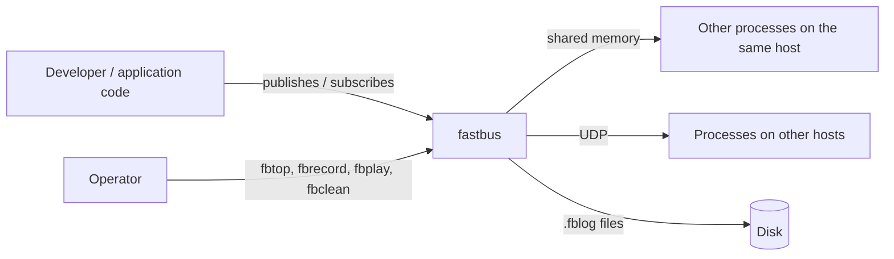
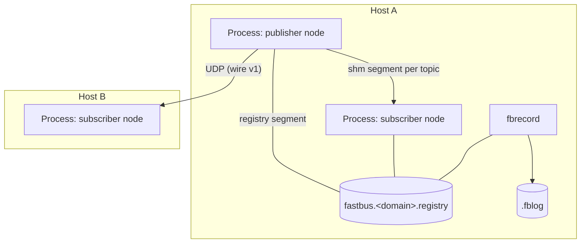
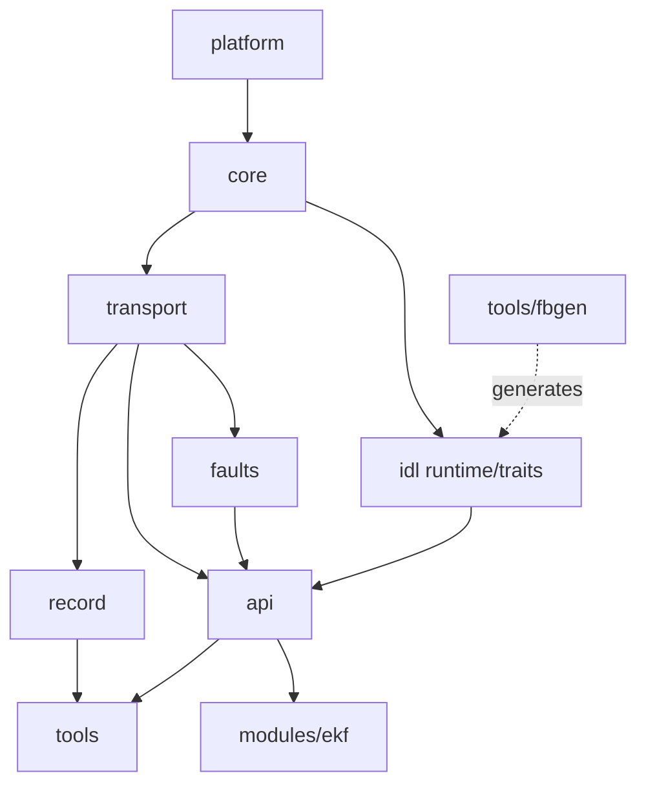
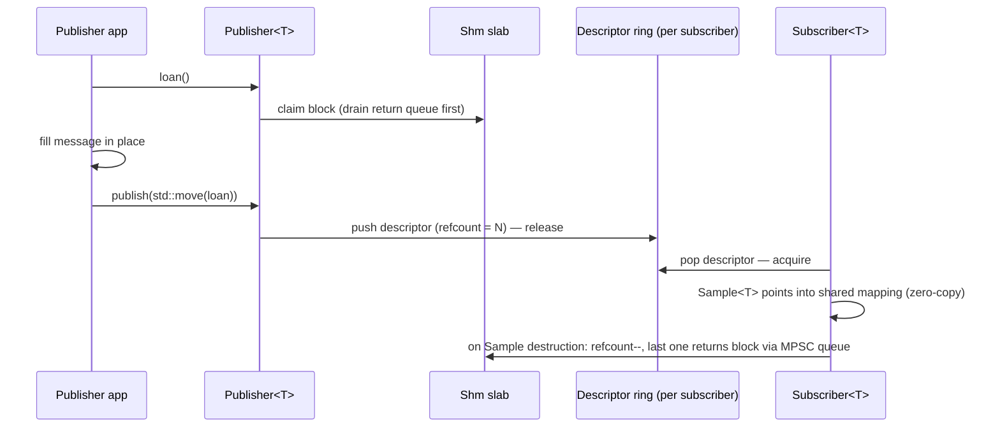

# fastbus — Design plan

> Status: **draft (G0.3)** — owner review pending. Detailed per-mechanism designs live in the `PRD_<mechanism>.md` files, written just before the milestone that builds them.

## 1. C4 — Context

## 2. C4 — Containers (deployment)

## 3. C4 — Components (module layering, G0.2)

**Layering rules** (enforced by `scripts/check_layering.py`):
- A module includes only lower layers (arrows point from dependency to dependent).
- `tools/` use `api` + `record` (+ generated messages); `examples/` and `modules/ekf` use **only** `api` + generated messages.
- Only `platform` includes OS headers; backend chosen at build time (ADR-002).

## 4. Module responsibilities

| Module | Responsibility | Milestone |
|---|---|---|
| platform | Clocks, threads, shared memory, processes, sockets, CRC32C dispatch | M1, M2, M6 |
| core | Strong types, `Result`, SPSC/MPSC rings, slab, message header | M1, M2 |
| transport | Shm segments + loans, UDP + reliability, `Transport` concept | M2, M6 |
| faults | Seeded fault-injection decorator, `SimNetwork` | M6 |
| record | `.fblog` recorder/player | M5 |
| idl (runtime) | `MessageTraits`, descriptors, schema adaptation | M4 |
| api | `Node`, `Publisher<T>`, `Subscriber<T>`, QoS, discovery, executor | M3 |
| tools | fbgen, fbtop, fbrecord, fbplay, fbbench, fbinfo, fbclean | M2–M9 |
| modules/ekf | EKF sensor fusion, separate version | M7 |

## 5. Data flow — publish path (target design, M2/M3)

## 6. Threading model

- `Publisher` objects are single-threaded; multiple publishers per topic use the MPSC side.
- Each `Node` owns one discovery thread (off the hot path) and one executor thread for callbacks.
- Polling consumers run on the caller's thread.
- No locks on the hot path; cross-process coordination uses atomics in shared memory only.

## 7. Deployment

| Resource | Naming | Lifetime |
|---|---|---|
| Registry segment | `fastbus.<domain>.registry` | creator-owned, stale reaping via pid + start time |
| Topic segments | per topic/publisher | creator-owned; `fbclean` removes stale ones |
| UDP peers | static JSON peer list | per process |
| Logs | `*.fblog` | user-managed files |
