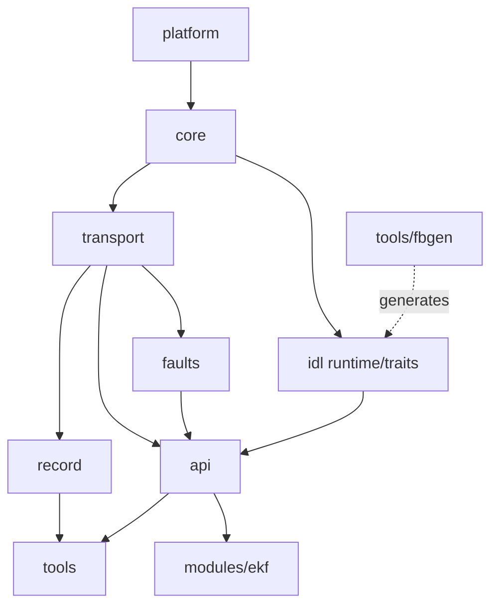

# fastbus — TODO.md

> Living task tracker for the fastbus project. Updated at the start and end of every work session.
> Source of truth for scope: `docs/PRD.md`. Source of truth for design: `docs/PLAN.md`.
>
> **Current state (2026-10-18):** G0.1 decisions confirmed. M0 done — CI fully green on Windows + Linux ([run](https://github.com/YanalSerhan/FastBus/actions/runs/38907993718)), report in [milestones/M0-report.md](milestones/M0-report.md). M1 approved and in progress ([milestones/M1-plan.md](milestones/M1-plan.md)); steps 1–2 (M1.1 types, M1.2 clocks) done; M1 done ([report](milestones/M1-report.md)). M2 started: M2.0 docs proposed and awaiting owner approval; M2.1 shared memory and M2.2 processes implemented, Windows backend awaiting CI ([M2 plan](milestones/M2-plan.md)).

## 0. How to read this file

**Status:** `[ ]` todo · `[~]` in progress · `[x]` done · `[!]` blocked · `[-]` dropped (with reason)
**Priority:** `P0` required for the CV story · `P1` should do · `P2` stretch (first to cut)
**Effort:** `S` ≤ 2 h · `M` ≈ half day · `L` 1–2 days · `XL` > 2 days (split further before starting)
**IDs:** `M<milestone>.<n>`; subtasks are nested checkboxes. `G0.*` are pre-M0 gates.

**Rules of engagement (from the working agreements)**
- One milestone at a time. The next one starts only when the owner says so.
- Before each milestone: restate scope + acceptance criteria, list files, get a "go".
- Tests first or alongside. A test commit precedes or accompanies the feature commit it covers.
- Never mark `[x]` unless it was actually run (locally or in CI) and the evidence is linked in the task.
- Every milestone ends with: summary, what was verified, known limitations, "explain-it-in-an-interview" list, 3 interview Q&As, updated CHANGELOG / known-issues / design-decisions.
- No code is written for a mechanism until its `docs/PRD_<mechanism>.md` is approved.

---

## 1. Global Definition of Done (applies to every milestone)

- [ ] Builds with **zero warnings** on MSVC (`/W4 /WX`), GCC and Clang (`-Wall -Wextra -Wpedantic -Werror` + extras listed in M0.3).
- [ ] All unit + integration tests pass on Windows (MSVC) and Linux (GCC, Clang).
- [ ] ASan, UBSan, TSan CI jobs are green (TSan only for in-process concurrency tests; see Risk R3).
- [ ] `clang-format --dry-run --Werror` and `clang-tidy` (checked-in config, warnings-as-errors) pass.
- [ ] Line coverage of the milestone's new code ≥ **85 %** (gate introduced in M1).
- [ ] Every new public header/class/function has a Doxygen comment (what/why, preconditions, thread-safety, error behavior).
- [ ] Hot-path rules verified: no heap allocation, no exceptions, no locks, no syscalls (see §3.2 checklist).
- [ ] Benchmarks do not regress beyond the agreed threshold (active from M9; informational before).
- [ ] `docs/CHANGELOG.md`, `docs/known-issues.md`, `docs/design-decisions.md` updated.
- [ ] Per-mechanism PRD(s) updated to match what was actually built.
- [ ] Conventional-commit history is clean (no "wip", no giant mixed commits).
- [ ] Milestone report written (summary, verified, limitations, interview prep).

---

## 2. Gate 0 — decisions and docs before any code

### G0.1 Open questions (answer before M0 starts)  — `P0, S`
- [x] **Q1 Dependencies.** Allow these pinned FetchContent deps: GoogleTest, Google Benchmark, CLI11, nlohmann_json (scenario/config files), Eigen (EKF, fixed-size = no heap)? *Proposed default: yes to all five.* → *confirmed by owner 2026-10-16 (proposed default adopted; see design-decisions.md)*
- [x] **Q2 Zero-copy fan-out design.** (a) per-subscriber rings carrying *descriptors* into a publisher-owned shared slab with refcounts (true zero-copy to N subscribers), or (b) per-subscriber rings carrying full messages (copy per extra subscriber). *Proposed default: (a), decided formally in ADR-003 at the start of M2.* → *confirmed by owner 2026-10-16 (proposed default adopted; see design-decisions.md)*
- [x] **Q3 File-size rule.** Adopt the 150-code-line-per-file guideline from the attached standards? *Proposed default: soft limit (CI warning > 150 code lines, fail > 300) for hand-written `src/` and `include/`; tests, benchmarks, generated code, and platform impls are exempt but listed in `known-issues.md`.* → *confirmed by owner 2026-10-16 (proposed default adopted; see design-decisions.md)*
- [x] **Q4 Toolchain.** MSVC (VS generator) as primary on Windows, clang-cl + Ninja as secondary (needed for local clang-tidy via `compile_commands.json`), WSL2 for local Linux/sanitizer runs? Minimum OS: Windows 10+, Ubuntu 22.04+. macOS out of scope. → *confirmed by owner 2026-10-16 (proposed default adopted; see design-decisions.md)*
- [x] **Q5 License/attribution.** MIT, copyright holder name + year (2026) for the LICENSE file. Repo public from day one or private until M10? → *confirmed by owner 2026-10-16 (proposed default adopted; see design-decisions.md)*

### G0.2 Architecture approval  — `P0, M`
- [x] Present the module dependency graph (below) and get approval. → *approved by owner 2026-10-17*
- [x] Agree on layering rules: lower layers never include upper-layer headers; `tools/`, `examples/`, `modules/ekf` consume **only** the public API (`fastbus/api` + generated messages). → *approved 2026-10-17; enforced by scripts/check_layering.py*



### G0.3 Planning documents  — `P0, M`
- [~] `docs/PRD.md`: purpose, target users/recruiters, problem statement, goals/non-goals, KPIs (latency/throughput targets as *hypotheses*, final numbers filled in M9), acceptance criteria, constraints, risks. → *draft*
- [~] `docs/PLAN.md`: C4 diagrams (Context/Container/Component) in Mermaid, module responsibilities, data flow, threading model, deployment (processes, shm segments, UDP peers). → *draft*
- [x] `docs/TODO.md` (this file) committed. → *committed by owner*
- [x] `docs/design-decisions.md` created with ADR index (stubs below).
- [x] Per-mechanism PRD stubs created (filled just before the milestone that builds them): `PRD_spsc_ring.md`, `PRD_mpsc_queue.md`, `PRD_shm_transport.md`, `PRD_api_qos_discovery.md`, `PRD_idl.md`, `PRD_record_replay.md`, `PRD_udp_reliable.md`, `PRD_fault_injection.md`, `PRD_ekf.md`, `PRD_benchmarks.md`.
- [x] Each PRD includes the **building-block contract**: Input data / Output data / Setup data (per the standards doc §16). → *section present in every stub*

### G0.4 ADR stubs to create (each gets Context / Options / Decision / Consequences)
- [x] ADR-001 Error handling without exceptions on hot path: C++20 has no `std::expected` → own `Result<T,E>` (`[[nodiscard]]`), or pinned `tl::expected`. → *accepted 2026-10-17*
- [~] ADR-002 Platform abstraction by build-time source selection (`platform/windows/*.cpp` vs `platform/posix/*.cpp`), zero `#ifdef` in core logic. → *written 2026-10-18 (M2.0), proposed, awaiting owner approval*
- [~] ADR-003 Fan-out/zero-copy design (Q2). → *written 2026-10-18 (M2.0), proposed, awaiting owner approval*
- [~] ADR-004 Wire/shm layout: little-endian only, `static_assert(std::endian::native == std::endian::little)`, no pointers in shared memory (offsets only), explicit padding. → *written 2026-10-18 (M2.0), proposed, awaiting owner approval*
- [~] ADR-005 Checksum: CRC32C (software table + SSE4.2/ARM CRC when available); optional on shm hot path, mandatory on UDP and log. → *written 2026-10-18 (M2.0), proposed, awaiting owner approval*
- [~] ADR-006 PRNG: own PCG32/xoshiro256** + own distributions (`<random>` distributions are implementation-defined → not reproducible across MSVC/libstdc++/libc++). → *stub in docs/adr/*
- [x] ADR-007 Time: injectable `Clock` interface; modules never call `steady_clock::now()` directly. → *accepted 2026-10-17*
- [~] ADR-008 Transport interface: static (concepts) vs dynamic (virtual) polymorphism; how fault layer wraps loan-based transports. → *stub in docs/adr/*
- [x] ADR-009 Cache-line constant: hard-coded 64 (128 on some ARM) rather than `std::hardware_destructive_interference_size` (GCC `-Winterference-size` ABI warning). → *accepted 2026-10-17*
- [~] ADR-010 Registry concurrency: lock-free slot claim vs cross-process robust mutex. → *stub in docs/adr/*
- [~] ADR-011 Benchmark methodology and regression policy. → *stub in docs/adr/*

---

## 3. Cross-cutting tracks (run through every milestone)

### 3.1 Documentation ritual (end of every milestone)
- [ ] CHANGELOG entry (Keep-a-Changelog format, SemVer).
- [ ] `known-issues.md`: each known limitation with ID, impact, workaround, planned fix.
- [ ] `design-decisions.md`: every non-obvious decision (memory ordering, false sharing, layout/ABI, SPSC vs MPSC) with trade-offs.
- [ ] `docs/bug-log.md`: **every genuine bug hit during development** (symptom, how found, root cause, fix commit). This is the raw material for M8; do not skip it in M1–M7.
- [ ] Interview prep: 3 Q&As appended to `docs/interview-prep.md`.
- [ ] Optional `docs/prompt-log.md` (AI-assistance log per the standards doc §8.3): date, intent, prompt summary, outcome. Keep it honest; you must be able to explain every line.

### 3.2 Hot-path checklist (copy into PR template; applies to publish/loan/take/poll/callback dispatch)
- [ ] No `new`/`malloc`/`std::string`/`std::vector` growth/`std::function` allocation.
- [ ] No exceptions (`throw`/`try` banned in hot-path directories; CI grep + `-fno-exceptions` build of `core`/`transport` on GCC/Clang).
- [ ] No mutexes, no syscalls, no logging I/O (counters only).
- [ ] Atomics use the weakest correct ordering with a comment citing the happens-before edge.
- [ ] Shared structs: trivially copyable, standard layout, `static_assert`ed size/alignment/offsets, zero-initialized padding.
- [ ] Counting-allocator test (M3.12) still passes.

### 3.3 Versions inventory (kept in `docs/versions.md`; every versioned artifact has a version field validated on load)
| Artifact | Where | Initial |
|---|---|---|
| Library (SemVer) | `project(VERSION)`, `fastbus/version.hpp` | 0.1.0 |
| Shm segment layout | `SegmentHeader.layout_version` | 1 |
| Message header | `MessageHeader.header_version` | 1 |
| UDP wire protocol | packet header `wire_version` | 1 |
| Log format | `.fblog` header `format_version` | 1 |
| IDL language | `fbgen --lang-version` | 1 |
| Message schema | `@version(N)` per type | 1 |
| Config files | `"version"` key in each JSON | "1.00" |
| EKF module interface | `modules/ekf` project version + message schemas | 1.0.0 |

### 3.4 Naming and style rules (written into `.clang-tidy` + CONTRIBUTING)
- Types `CamelCase`, functions/variables `snake_case`, members `snake_case_`, constants `kCamelCase`, namespaces `lower`, macros `FASTBUS_UPPER` (macros only for platform/compiler detection in `platform/` and build config).
- Strong types for `TopicId`, `NodeId`, `PublisherId`, `SequenceNumber`, `Timestamp`, `Duration`, `TypeId`, `SchemaVersion` (explicit ctor, no implicit conversions, comparison ops, hashing).
- All config values live in JSON config files or `constants.hpp`. No magic numbers in code (tests may use literals with named constants).

---

## M0 — Repo scaffold  (≈ 2–3 days)

**Scope:** layout, CMake + presets, formatting/lint configs, CI (Windows + Linux gcc/clang + sanitizer matrix), docs skeleton, one trivial test and one trivial benchmark wired into CI.

**Acceptance criteria**
- A fresh clone builds and tests with one command per preset on Windows (MSVC) and Linux (gcc, clang).
- CI is green on all matrix jobs; a deliberate warning breaks CI (proved on a scratch branch).
- TSan canary proves the sanitizer is actually active.
- Benchmark smoke run executes in CI.
- README, CONTRIBUTING, LICENSE, CHANGELOG, known-issues, design-decisions exist.

### M0.1 Repository hygiene  — `P0, M`
- [-] `git init`, default branch `main`, protected (require PR + passing checks) once CI exists. → *repo already cloned from GitHub; branch protection is set by the owner once CI is green*
- [x] `.gitignore` (build dirs, `CMakeUserPresets.json`, IDE folders, `*.fblog` except test fixtures, `results/` large outputs).
- [x] `.gitattributes`: `* text=auto`, `eol=lf` for `*.hpp *.cpp *.md *.json *.fbidl *.cmake` and golden files; `eol=crlf` only for `*.bat/*.ps1` if any. **Golden-file tests break on Windows without this.**
- [x] `.editorconfig` (utf-8, LF, final newline, indent).
- [x] `LICENSE` (MIT, 2026, owner per Q5).
- [x] `README.md` skeleton (sections: What/Why, Status, Architecture (placeholder), Quickstart (placeholder), Benchmarks (placeholder), Bugs found (placeholder), Repo layout, License).
- [x] `CONTRIBUTING.md`: build per OS, presets, running sanitizers (WSL2), commit convention, PR checklist (incl. hot-path checklist), how to add a test.
- [x] `SECURITY.md` (short), `.github/ISSUE_TEMPLATE/*`, `.github/pull_request_template.md`.
- [x] `docs/CHANGELOG.md`, `docs/known-issues.md`, `docs/design-decisions.md`, `docs/testing-strategy.md` (skeleton), `docs/versions.md`.
- Commit: `chore(repo): add license, gitattributes, editorconfig and contribution docs`

### M0.2 Directory layout  — `P0, S`
```
fastbus/
├── CMakeLists.txt  CMakePresets.json  vcpkg.json (optional)
├── cmake/                  # Warnings, Sanitizers, Dependencies, Coverage, Tidy, Platform, Generate
├── include/fastbus/{platform,core,transport,api,idl,record,faults}/   # public headers only
├── src/{platform/{windows,posix},core,transport,api,idl,record,faults}/
├── tools/{fbgen,fbtop,fbrecord,fbplay,fbbench,fbinfo,fbclean}/
├── modules/ekf/{include,src,idl,config,tests}/
├── idl/                    # shared .fbidl files
├── tests/{unit,integration,stress,chaos,golden,canary,helpers}/
├── benchmarks/
├── examples/
├── config/                 # versioned JSON: qos profiles, fault scenarios, sim params, bench params
├── docs/{formats,bugs,images}/
├── scripts/                # Python (uv) plotting/analysis; check_file_length; check_layering
├── notebooks/ results/ assets/ data/
└── .github/{workflows,ISSUE_TEMPLATE}
```
- [x] Create dirs with a placeholder `CMakeLists.txt` + one-paragraph `README.md` per module (responsibility, public surface, dependencies, building-block I/O/Setup).
- Public headers under `include/fastbus/<module>/`; private headers beside sources in `src/`.

### M0.3 CMake core  — `P0, L`
- [x] Root `CMakeLists.txt`: `cmake_minimum_required(VERSION 3.24)`, `project(fastbus VERSION 0.1.0 LANGUAGES CXX)`, C++20, `CMAKE_CXX_EXTENSIONS OFF`, `CMAKE_EXPORT_COMPILE_COMMANDS ON`, forbid in-source builds. — *evidence: local run 2026-10-16, Linux, GCC 13.3 / Clang 18.1*
- [x] Options: `FASTBUS_BUILD_TESTS/BENCHMARKS/EXAMPLES/TOOLS` (default ON when top-level), `FASTBUS_WARNINGS_AS_ERRORS` (default ON), `FASTBUS_SANITIZER` (none|address|undefined|thread), `FASTBUS_COVERAGE`, `FASTBUS_ENABLE_TIDY`. — *evidence: local run 2026-10-16, Linux, GCC 13.3 / Clang 18.1*
- [x] `cmake/Warnings.cmake` → INTERFACE target `fastbus::warnings`, applied **only to our targets** (never to FetchContent deps). — *evidence: MSVC 19.44 / clang-cl 19.1 / GCC 13 / Clang 18 all `-Werror`-clean in [CI run 38907993718](https://github.com/YanalSerhan/FastBus/actions/runs/38907993718)*
  - MSVC: `/W4 /WX /permissive- /Zc:__cplusplus /utf-8 /external:W0`
  - GCC/Clang: `-Wall -Wextra -Wpedantic -Werror -Wshadow -Wconversion -Wsign-conversion -Wold-style-cast -Wnon-virtual-dtor -Woverloaded-virtual -Wcast-align -Wnull-dereference -Wdouble-promotion -Wformat=2`
  - Document any intentionally disabled warning with a reason.
- [x] `cmake/Sanitizers.cmake`: ASan, UBSan (`-fno-sanitize-recover=all`), TSan; `-fno-omit-frame-pointer`; refuse invalid combos (TSan+ASan); MSVC ASan (`/fsanitize=address`) as optional P1 preset. — *evidence: Linux ASan/UBSan/TSan + MSVC ASan jobs green (canaries detected) in [CI run 38907993718](https://github.com/YanalSerhan/FastBus/actions/runs/38907993718); MSVC ASan also locally on VS 17.14*
- [x] `cmake/Dependencies.cmake`: FetchContent, **pinned by tag + commit SHA** (verify the current stable tags at M0 time and record them in `docs/versions.md`): GoogleTest (`gtest_force_shared_crt ON` for MSVC), Google Benchmark (`BENCHMARK_ENABLE_TESTING=OFF`), CLI11. Note: FetchContent's `SYSTEM` keyword needs CMake 3.25; with 3.24, mark include dirs as SYSTEM manually via target properties. — *evidence: local run 2026-10-16, Linux, GCC 13.3 / Clang 18.1*
- [x] `cmake/Platform.cmake`: select `src/platform/windows` or `src/platform/posix`; link `Threads::Threads`, `ws2_32`, `rt`/`dl` where needed (older glibc needs `-lrt` for `shm_open`). — *evidence: windows + posix backends both configured in [CI run 38907993718](https://github.com/YanalSerhan/FastBus/actions/runs/38907993718)*
- [x] `cmake/Coverage.cmake`: gcov/lcov (GCC) or llvm-cov (Clang) flags; report target. — *evidence: local run 2026-10-16, Linux, GCC 13.3 / Clang 18.1* (gcovr 8.6)
- [x] Helper `fastbus_add_library()` / `fastbus_add_test()` / `fastbus_add_benchmark()` so every target gets warnings, include dirs, aliases (`fastbus::core` …), and `ctest` registration consistently. — *evidence: local run 2026-10-16, Linux, GCC 13.3 / Clang 18.1*
- [x] Generated `fastbus/version.hpp` from `version.hpp.in`. — *evidence: local run 2026-10-16, Linux, GCC 13.3 / Clang 18.1*
- Commit: `build(cmake): add project skeleton, warning/sanitizer modules and target helpers`

### M0.4 CMakePresets.json  — `P0, M`
Use preset `"version": 5` (needs CMake 3.24; workflow presets would need 3.25, so skip those). Hidden base presets + host-OS `condition`.
- [x] Configure presets: `windows-msvc` (VS 2022 generator), `windows-clangcl` (Ninja, exports `compile_commands.json`), `linux-gcc`, `linux-clang`, `linux-asan`, `linux-ubsan`, `linux-tsan`, `linux-coverage`, `linux-bench` (Release + `-fno-omit-frame-pointer`), optional `windows-asan`. — *evidence: all presets used in [CI run 38907993718](https://github.com/YanalSerhan/FastBus/actions/runs/38907993718); windows-tidy added*
- [x] Matching build presets (multi-config needs `configuration`) and test presets (`outputOnFailure`, `--output-junit` for CI summaries, per-preset label filters). — *JUnit via `ctest --output-junit` on the command line (test-preset `outputJUnitFile` needs preset v6 / CMake 3.25)*
- [x] `CMakeUserPresets.json.example` for local overrides (gitignored real file).
- [x] Verify: `cmake --list-presets` shows the right set on each OS. — *Linux (local) and Windows (owner machine) verified*

### M0.5 Format and lint configs  — `P0, M`
- [x] `.clang-format` (choose base style, 100 cols, document choice), CMake targets `format` and `format-check`. — *evidence: local run 2026-10-16, Linux, GCC 13.3 / Clang 18.1* (clang-format 18)
- [x] `.clang-tidy` checked in: `bugprone-*, cert-*, concurrency-*, cppcoreguidelines-*` (curated), `misc-*, modernize-*, performance-*, readability-*`; `WarningsAsErrors: '*'`; `readability-identifier-naming` per §3.4; every disabled check documented with a reason in the file. — *evidence: local run 2026-10-16, Linux, GCC 13.3 / Clang 18.1* (naming + const-correctness violations fail the build)
- [x] clang-tidy runs on Linux CI via `compile_commands.json`; locally on Windows via `windows-clangcl` preset (VS generator doesn't emit compile commands). — *Linux `tidy` job + Windows `windows-tidy` job green in [CI run 38907993718](https://github.com/YanalSerhan/FastBus/actions/runs/38907993718)*
- [x] Optional `.pre-commit-config.yaml` running clang-format.
- [x] `scripts/check_file_length.py` (counts code lines excluding blanks/comments; policy per Q3) and `scripts/check_layering.py` (include-graph rule check) — stubs wired into CI. — *evidence: local run 2026-10-16, Linux, GCC 13.3 / Clang 18.1*

### M0.6 Trivial code, test and benchmark  — `P0, S`
- [x] `fastbus::version()` returning `constexpr` version info. — *evidence: local run 2026-10-16, Linux, GCC 13.3 / Clang 18.1*
- [x] GoogleTest: `tests/unit/version_test.cpp`, discovered via `gtest_discover_tests`. — *evidence: local run 2026-10-16, Linux, GCC 13.3 / Clang 18.1*
- [x] Google Benchmark: `benchmarks/bm_smoke.cpp`; CI runs it with a tiny min-time (check the exact `--benchmark_min_time` syntax of the pinned version: newer versions take `0.01s`, older ones a bare number). — *evidence: local run 2026-10-16, Linux, GCC 13.3 / Clang 18.1* (v1.9.4 accepts `0.01s`)
- [x] **Canary tests** (`tests/canary/`, only built in sanitizer presets, marked `WILL_FAIL TRUE`): deliberate data race (TSan), heap overflow (ASan), signed overflow (UBSan). They prove each sanitizer is really active. — *evidence: local run 2026-10-16, Linux, GCC 13.3 / Clang 18.1* (pass criterion: sanitizer report text via `PASS_REGULAR_EXPRESSION`, stricter than `WILL_FAIL`)

### M0.7 GitHub Actions  — `P0, L`
- [x] `ci.yml` jobs: `format-check`; `build-test` matrix (windows-msvc; ubuntu gcc and clang with the versions actually installed on the runner image — verify, don't assume); `sanitizers` (asan, ubsan, tsan as separate jobs); `tidy`; `coverage` (report only in M0, gate ≥ 85 % from M1); `bench-smoke`; `docs-check` (markdown links). — *all jobs green in [CI run 38907993718](https://github.com/YanalSerhan/FastBus/actions/runs/38907993718)*
- [x] Hygiene: `permissions: contents: read`, `concurrency` cancel-in-progress, actions pinned by SHA, `dependabot.yml` for actions, ccache + FetchContent cache, upload `Testing/` logs and JUnit XML on failure. — *evidence: [CI run 38907993718](https://github.com/YanalSerhan/FastBus/actions/runs/38907993718)*
- [x] TSan runner quirk: on recent Ubuntu kernels TSan can crash with "unexpected memory mapping" due to ASLR entropy; add a step `sudo sysctl vm.mmap_rnd_bits=28` before TSan runs. — *TSan job green in [CI run 38907993718](https://github.com/YanalSerhan/FastBus/actions/runs/38907993718)*
- [x] README badges: CI, license (coverage badge later).
- Commit: `ci: add build, sanitizer, lint and benchmark-smoke workflows`

### M0.8 Developer ergonomics  — `P1, S`
- [x] `.vscode/` recommendations (CMake Tools, clangd, clang-format) and `settings.json` using presets.
- [x] CONTRIBUTING: WSL2 recipe for running `linux-*` presets from Windows.
- [x] Windows-first workflow (owner has no Linux): `scripts/dev.ps1`, `windows-tidy` preset, clang-cl warning fix, MSVC ASan runtime staging, CI Windows matrix via `dev.ps1`. — *owner machine: `dev.ps1 doctor` + build/test/ASan green; CI Windows matrix green in [CI run 38907993718](https://github.com/YanalSerhan/FastBus/actions/runs/38907993718)*

### M0.9 Verification  — `P0, M`
- [x] Clean clone → configure/build/test passes on: Windows MSVC (local), Linux gcc/clang (CI or WSL2). — *Windows MSVC on owner machine, Linux GCC/Clang in [CI run 38907993718](https://github.com/YanalSerhan/FastBus/actions/runs/38907993718)*
- [~] Scratch branch with an unused variable → CI fails on all compilers (evidence linked). — *verified locally (GCC, Clang, clang-tidy fail on an unused variable); CI scratch-branch run left to the owner*
- [x] Canary tests fail as expected under each sanitizer. — *ASan/UBSan/TSan canaries + MSVC ASan canary detected in [CI run 38907993718](https://github.com/YanalSerhan/FastBus/actions/runs/38907993718)*
- [x] `format-check` fails on a mis-formatted file; passes after `format`. — *evidence: local run 2026-10-16 (clang-format 18)*
- [ ] Record evidence (CI run links) in this task.

### M0.10 Milestone report  — `P0, S`
- [x] Summary, verified items, limitations, interview prep. → *[docs/milestones/M0-report.md](milestones/M0-report.md)*
- Interview prompts: (1) Why CMake presets and per-target warning flags instead of global flags? (2) How do you keep platform code out of core logic? (3) How do you know your sanitizer job is really checking something?

---

## M1 — Platform layer + lock-free SPSC ring  (≈ 1–1.5 weeks)

**Scope:** strong types, clocks, thread utilities, in-process SPSC ring (designed as a *view over caller-provided memory* so M2 can place it in shared memory), unit + stress tests, TSan-clean, memory-ordering document.

**Acceptance criteria**
- Ring passes unit, edge-case, and stress tests on MSVC/GCC/Clang; ASan/UBSan/TSan clean.
- `docs/memory-ordering.md` gives a complete happens-before argument for every atomic operation.
- Coverage gate ≥ 85 % active in CI for `platform` + `core`.
- No heap allocation inside push/pop (verified by test, see M1.9).

### M1.0 Docs first  — `P0, M`
- [x] `docs/PRD_spsc_ring.md`: purpose, invariants, API contract, input/output/setup data, edge cases (full, empty, wrap), performance hypotheses, non-goals (no blocking, no multi-producer).
- [x] ADR-001, ADR-007, ADR-009 written. → *accepted 2026-10-17*

### M1.1 Strong types and error handling  — `P0, M`
- [x] `fastbus/core/strong_type.hpp` (tag-based, explicit ctor, `value()`, comparisons, hash) + `TopicId, NodeId, PublisherId, SequenceNumber, TypeId, SchemaVersion`. — *local run 2026-10-17: GCC 13, Clang 18, ASan/UBSan/TSan, clang-tidy, 92 % line coverage; MSVC/clang-cl/Windows tidy green in CI*
- [x] `Timestamp` (int64 ns since clock epoch) and `Duration` strong types; arithmetic only between valid combos (`Timestamp - Timestamp = Duration`). — *local run 2026-10-17: GCC 13, Clang 18, ASan/UBSan/TSan, clang-tidy, 92 % line coverage; MSVC/clang-cl/Windows tidy green in CI*
- [x] `Result<T, E>` + `Error` (code enum + static message; no allocation); `[[nodiscard]]`. — *local run 2026-10-17: GCC 13, Clang 18, ASan/UBSan/TSan, clang-tidy, 92 % line coverage; MSVC/clang-cl/Windows tidy green in CI*
- [x] Tests: compile-time (`static_assert(!std::is_convertible_v<...>)`), arithmetic, hashing, `Result` monad-ish helpers. — *local run 2026-10-17: GCC 13, Clang 18, ASan/UBSan/TSan, clang-tidy, 92 % line coverage; MSVC/clang-cl/Windows tidy green in CI*

### M1.2 Platform: clocks  — `P0, M`
- [x] `Clock` interface (+ `SystemMonotonicClock`, `WallClock`) returning strong `Timestamp`. Windows impl via `QueryPerformanceCounter`/`GetSystemTimePreciseAsFileTime`; POSIX via `clock_gettime(CLOCK_MONOTONIC / CLOCK_REALTIME)`. Document that the monotonic clock is system-wide (needed for cross-process latency). — *local run 2026-10-17: GCC 13, Clang 18, ASan/UBSan/TSan, clang-tidy 18, 30× repeat stable; Windows (MSVC Debug/Release, clang-cl, MSVC ASan, clang-tidy 19) green in CI, owner-confirmed 2026-10-17*
- [x] `ManualClock` (test/sim clock, advance explicitly) for ADR-007. — *local run 2026-10-17: GCC 13, Clang 18, ASan/UBSan/TSan, clang-tidy 18, 30× repeat stable; Windows (MSVC Debug/Release, clang-cl, MSVC ASan, clang-tidy 19) green in CI, owner-confirmed 2026-10-17*
- [x] `sleep_until` / `sleep_for` helpers + spin-wait helper; document Windows timer-resolution caveat (`timeBeginPeriod`) and make it an explicit opt-in utility. — *local run 2026-10-17: GCC 13, Clang 18, ASan/UBSan/TSan, clang-tidy 18, 30× repeat stable; Windows (MSVC Debug/Release, clang-cl, MSVC ASan, clang-tidy 19) green in CI, owner-confirmed 2026-10-17*
- [x] Tests: monotonic non-decreasing across 1e6 calls, measured resolution/overhead reported (not asserted tightly), `ManualClock` determinism. — *local run 2026-10-17: GCC 13, Clang 18, ASan/UBSan/TSan, clang-tidy 18, 30× repeat stable; Windows (MSVC Debug/Release, clang-cl, MSVC ASan, clang-tidy 19) green in CI, owner-confirmed 2026-10-17*

### M1.3 Platform: thread utilities  — `P0, S`
- [x] `cpu_relax()` (`_mm_pause` / `YieldProcessor` / ARM `yield`), `set_thread_affinity(core)`, `set_thread_name`, `current_thread_id`, `hardware_concurrency`. — *`cpu_relax()` in M1.2; rest in `fastbus/platform/thread.hpp` as `pin_current_thread` / `unpin_current_thread` / `set_current_thread_name` / `current_thread_name` / `current_thread_id` / `current_cpu` / `hardware_concurrency`; local run 2026-10-17: GCC 13, Clang 18, ASan/UBSan/TSan, clang-tidy 18, format/length/layering clean; pinning test ran (not skipped) here; Windows (MSVC Debug/Release, clang-cl, MSVC ASan, clang-tidy 19) green in CI, owner-confirmed 2026-10-17*
- [x] Tests: affinity success where permitted, else `GTEST_SKIP()` with reason (CI containers may forbid it). — `tests/unit/thread_test.cpp` (8 tests) — *local run 2026-10-17: GCC 13, Clang 18, ASan/UBSan/TSan, clang-tidy 18, format/length/layering clean; pinning test ran (not skipped) here; Windows (MSVC Debug/Release, clang-cl, MSVC ASan, clang-tidy 19) green in CI, owner-confirmed 2026-10-17*

### M1.4 Ring layout and ordering design  — `P0, L`
- [x] `fastbus/core/cache_line.hpp`: `inline constexpr size_t kCacheLine = 64`. — named `kCacheLineSize` (64) plus `kFalseSharingRange` (128) per ADR-009; *local run 2026-10-17: GCC 13, Clang 18, ASan/UBSan/TSan, coverage, clang-tidy 18, format/length/layering clean; Windows CI green, owner-confirmed 2026-10-17*
- [x] `SpscRingLayout<IndexT>` (POD, placeable in shared memory later): `alignas(kCacheLine) std::atomic<IndexT> head; alignas(kCacheLine) std::atomic<IndexT> tail;` plus producer-local `cached_head` and consumer-local `cached_tail` on their own lines; capacity power of two; monotonic indices (mask for slot index); `static_assert` on `is_always_lock_free`, sizes, offsets. — `fastbus/core/spsc_ring_layout.hpp`: `SpscRingHeader<IndexT>` (4 × 128-byte blocks: tail | cached_head + mask | head | cached_tail + mask; the mask is stored per side so neither hot path reads the other side's line) + `SpscRingLayout<T, IndexT>`; offsets/size/alignment static_asserted; *local run 2026-10-17: GCC 13, Clang 18, ASan/UBSan/TSan, coverage, clang-tidy 18, format/length/layering clean; Windows CI green, owner-confirmed 2026-10-17*
- [x] Document the rule that capacity must be ≤ half the index range for monotonic counters (so `tail - head` is unambiguous when counters wrap). — `docs/memory-ordering.md` §9, enforced by `SpscRingLayout::valid_capacity`, tested for `uint8_t`..`uint64_t`
- [x] Write `docs/memory-ordering.md` **before** implementing: — written 2026-10-17, before any ring code; approved by the owner 2026-10-17
  - Slot ownership: slots in `[head, tail)` owned by consumer, the rest by producer.
  - Producer: write slot data → `tail.store(release)`. Consumer: `tail.load(acquire)` → read slot → `head.store(release)`. Producer: `head.load(acquire)` before reusing a slot.
  - Why `relaxed` is enough for own-index loads, why `seq_cst` is unnecessary, why no standalone fences (TSan doesn't model `atomic_thread_fence` reliably).
  - Why cached indices reduce cache-line ping-pong and why they remain correct (staleness only makes the ring look fuller/emptier, never wrong).
  - Mermaid timeline diagram of the two threads.
- [x] Constraints on `T`: `std::is_trivially_copyable_v && std::is_standard_layout_v` (concept), so the same code is valid in shm. — `RingElement` (also: not const/volatile, `alignof(T) <= 64`) and `RingIndex` (unsigned, not bool, always lock-free); compile-time tests in `spsc_ring_layout_test.cpp`

### M1.5 Ring implementation  — `P0, L`
- [x] `SpscRingView<T, IndexT>` over caller-provided memory; `SpscRing<T>` owning wrapper (aligned allocation at construction only). — `core/spsc_ring_view.hpp`, `core/spsc_ring.hpp` (one `operator new(align_val_t{64}, nothrow)` in `create`); *local run 2026-10-17: GCC 13, Clang 18, ASan/UBSan/TSan (unit binary also 20× repeated under TSan), Release (misuse checks compiled out, death tests skipped), coverage, clang-tidy 18, format/length/layering clean; Windows CI green, owner-confirmed 2026-10-17*
- [x] API: `try_push(const T&)`, `try_claim()` → pointer + `commit()` (producer-side zero-copy hook for M2 loans), `try_pop(T&)`, `try_peek()` + `release()` (consumer-side zero-copy), `size_approx()`, `capacity()`, `empty_approx()`. — all implemented; plus `create(memory, capacity, start)` and `required_bytes`/`required_alignment`
- [x] Debug-only single-producer/single-consumer misuse detection (assert thread-id ownership). — `core/thread_owner.hpp` (binds on first use, `fail_fast` from another thread); also commit-without-claim and release-without-peek
- [x] Comments at each atomic op referencing the ordering doc. — tags [P1]..[Q2]; memory-ordering.md §12 checklist ticked

### M1.6 Unit tests  — `P0, M`
- [x] Capacity validation (reject non-power-of-two, zero); empty/full transitions; FIFO order; wrap-around with capacity 2/4/8; claim/commit and peek/release paths; `size_approx` bounds. — `tests/unit/spsc_ring_test.cpp` (also too-small/misaligned memory, 64-byte payloads, move, same-thread producer+consumer, `size_approx ≤ capacity` with a concurrent observer); *local run 2026-10-17: GCC 13, Clang 18, ASan/UBSan/TSan (unit binary also 20× repeated under TSan), Release (misuse checks compiled out, death tests skipped), coverage, clang-tidy 18, format/length/layering clean; Windows CI green, owner-confirmed 2026-10-17*
- [x] **Wrap-around with `IndexT = uint8_t`/`uint16_t`** in tests to exercise counter overflow cheaply. — `tests/unit/spsc_ring_wrap_test.cpp`: counters start just before the wrap (`create(..., start)`), ≥ 3 full counter wraps, full ring at max capacity across the wrap
- [x] Death/assert tests for misuse in debug builds (where supported). — 4 death tests; `GTEST_SKIP` in release builds

### M1.7 Stress tests  — `P0, L`
- [x] 1 producer / 1 consumer, ≥ 1e7 items normal (scaled down under TSan/ASan), payload = 64-byte block filled with a pattern derived from the sequence number; consumer verifies order, no loss/dup, **no torn payloads**. — `tests/stress/spsc_ring_stress_test.cpp`: 1e7 items in the `Balanced`/`BalancedZeroCopy` regimes (both the copy and the claim/peek APIs), 1/10 under sanitizers and coverage (`FASTBUS_STRESS_REDUCED`), `FASTBUS_STRESS_MULTIPLIER` for soak runs. **Mutation-checked:** publishing before writing the slot → 38 312 out-of-order + 2 482 torn items detected; `[P3]` weakened to `relaxed` → TSan data race on the slot `memcpy`. *local run 2026-10-17 (2-core Linux): GCC 13 Debug 52 s, Release 14 s, ASan 10 s, UBSan 9 s, TSan 17 s for the full suite, clang-tidy 18 clean; Windows CI green, owner-confirmed 2026-10-17*
- [x] Parametrize capacity {2, 64, 4096}, random `yield`/`cpu_relax` injection, optional core pinning, duration-bounded (time limit + ctest `TIMEOUT`). — 18 cases (6 regimes × 3 capacities), `RandomJitter` (xorshift-driven yield/spin on both sides), `Pinned` (producer on CPU 0, consumer on CPU 1; runs unpinned with a note if refused), 30 s internal limit + 120 s ctest timeout per case
- [x] Slow-consumer and slow-producer variants (full/empty regimes). — `SlowConsumer` (zero-copy, ring mostly full) and `SlowProducer` (copy, ring mostly empty)

### M1.8 Sanitizers + coverage gate  — `P0, M`
- [x] TSan, ASan, UBSan CI jobs run the unit + stress tests (reduced iteration counts). — the sanitizer jobs run the whole ctest preset (unit + stress + canary); stress at 1/10 of the items; MSVC ASan (`dev.ps1 asan`) likewise. *local run 2026-10-17 (2-core Linux): GCC 13 Debug 52 s, Release 14 s, ASan 10 s, UBSan 9 s, TSan 17 s for the full suite, clang-tidy 18 clean; Windows CI green, owner-confirmed 2026-10-17*
- [x] Activate coverage gate: fail below 85 % for `platform` and `core`. — `linux-coverage` preset sets `FASTBUS_COVERAGE_FAIL_UNDER=85`; `FASTBUS_COVERAGE_PATHS` limits the measurement to core + platform (later modules join when they reach the bar). Local: **86.6 % lines** (775/895), 89.6 % functions; gate verified to fail (rc=1) when set to 99. `fail_fast` excluded (runs only in aborting death-test children).
- [x] Record in `known-issues.md`: TSan is blind to cross-process access; ring logic is validated in-process with threads (same code path). — KI-005 updated

### M1.9 Allocation and micro-benchmarks  — `P1, M`
- [x] Counting `operator new/delete` hook test binary: assert zero allocations during N push/pop after setup. — `tests/alloc/spsc_ring_noalloc_test.cpp`: 0 allocations in 100 000 single-thread ops (push/pop, claim/commit, peek/release, size_approx) and in a 200 000-item two-thread transfer; `create` allocates exactly once; a control test proves the hook counts. **Mutation-checked:** a hidden `new`/`delete` in `try_push` → 50 000 / 210 797 allocations reported. *local run 2026-10-17: GCC 13, Clang 18, ASan/UBSan, Release, coverage (TSan and MSVC ASan excluded, KI-009); Windows CI green, owner-confirmed 2026-10-18*
- [x] `benchmarks/bm_spsc_ring.cpp`: single-thread push/pop cost; 2-thread throughput; baseline `mutex+deque` queue kept for M9 comparisons. — 8 benchmarks (8 B and 64 B payloads), baseline in `benchmarks/baseline_mutex_queue.hpp`; local results in `docs/benchmarks.md` (2.0 ns push+pop, 279 M items/s two-thread, 114× the baseline); CI runs it at smoke length. *local run 2026-10-17, 2-vCPU VM; Windows CI green, owner-confirmed 2026-10-18*

### M1.10 Milestone report  — `P0, S`
- [x] Milestone report `docs/milestones/M1-report.md`, CHANGELOG, README status, PRD updated to what was built, interview Q&As (M1 section of `interview-prep.md`). — *written 2026-10-17; closed 2026-10-18 (owner moved on to M2)*
- Interview prompts: (1) Why acquire/release and not seq_cst — which edges matter? (2) What is false sharing and how did you prevent and verify it? (3) Why monotonic indices with power-of-two masks, and what is the overflow constraint? Bonus: why does SPSC not suffer ABA?

---

## M2 — Shared-memory transport (2 processes), message header, loans, MPSC  (≈ 2 weeks)

**Scope:** platform shared memory + process utilities, segment protocol, slab allocator, message header, loan-based publish, MPSC variant, cross-process integration tests on Windows and Linux.

**Acceptance criteria**
- Two separate processes exchange ≥ 1e6 messages with order/integrity verification on Windows and Linux.
- Loan API demonstrably zero-copy (subscriber pointer lies inside the shared mapping; no memcpy on the path).
- Crashed publisher never exposes a torn message; stale segments are detected and recovered.
- MPSC passes multi-producer stress under TSan (in-process threads).

### M2.0 Docs and decisions  — `P0, M`
- [~] `PRD_shm_transport.md`, `PRD_mpsc_queue.md`; ADR-002, ADR-003 (fan-out: descriptor ring + slab + refcount vs full-message rings), ADR-004, ADR-005. — *written 2026-10-18, plus [milestones/M2-plan.md](milestones/M2-plan.md); proposed, awaiting owner approval (PRD_shm_transport §13, PRD_mpsc_queue §9). ADR-002 adds the `fastbus::vocabulary` layer so platform can return `Result`.*
- [~] Document the platform semantic gap: POSIX shm persists until unlinked; Windows mappings die with the last handle. Define fastbus semantics: *creator owns lifetime*; stale cleanup is explicit (`fbclean`). — PRD_shm_transport §3.1 (table + semantics), KI-010; pinned down by `SharedMemory.OpenerKeepsItsMappingAfterTheCreatorIsDestroyed` (per-OS expectation)

### M2.1 Platform: shared memory  — `P0, L`
- [~] `SharedMemory` RAII class: `create(name, size)`, `open(name)`, `data()`, `size()`, unlink-on-destroy for creator. Error via `Result`. — `include/fastbus/platform/shared_memory.hpp`; also `remove(name)` for stale cleanup, `bytes()`, `is_creator()`, `name()`; sizes rounded to pages so creator and opener agree on both OSes; new `ErrorCode`s AlreadyExists/NotFound/PermissionDenied/Timeout; *local run 2026-10-18: GCC 13, Clang 18, ASan/UBSan/TSan, clang-tidy 18, coverage, Release; 20× repeat stable; no segments left in /dev/shm; Windows backend = next CI run*
- [~] Windows: `CreateFileMappingW` + `MapViewOfFile`, `Local\fastbus_...` namespace (Global needs privileges), detect create-vs-open via `ERROR_ALREADY_EXISTS`. — `src/platform/windows/shared_memory.cpp` (`SEC_COMMIT`, last error cleared before the call, `VirtualQuery` for the opener's size); *Windows = next CI run*
- [~] POSIX: `shm_open(O_CREAT|O_EXCL|O_RDWR, 0600)`, `ftruncate`, `mmap(MAP_SHARED)`, name must start with `/` and contain no further `/`. — `src/platform/posix/shared_memory.cpp`, plus `posix_fallocate` so a full `/dev/shm` fails with OutOfMemory instead of SIGBUS later; a failed create undoes itself (tested). **Mutation-checked:** dropping `O_EXCL` → `CreateTwiceFailsWithAlreadyExists` fails
- [~] Name mangling/validation function shared by both backends; base address page-aligned (64 KB on Windows) so cache-line alignment holds. — `src/platform/common/shared_memory_common.cpp`: one portable rule (1–200 chars of `[A-Za-z0-9._-]`), prefix per backend; alignment asserted in tests
- [~] Tests: create/open/close, size mismatch, double-create error, data visible across two mappings in one process, cleanup on destruction. — `tests/unit/shared_memory_test.cpp` (13 tests): also invalid names, zero/huge size, opener outliving the creator (per-OS), stale `remove`, move, move-assign, and a **real child process** reading and writing the parent's segment. "Size mismatch" became "sizes agree after page rounding" (Windows cannot report exact sizes; the exact size lives in the M2.3 header)

### M2.2 Platform: process utilities  — `P0, M`
- [~] `Process::spawn(path, args)`, `wait(timeout)`, `kill()`, `is_alive(pid)`, `current_pid()`, process start time (to defeat **pid reuse** in liveness checks). — `include/fastbus/platform/process.hpp`: `ProcessIdentity` {pid, start_time}, `current_process()`, `identity_of(pid)`, `is_alive(identity)`; POSIX `posix_spawn` + `/proc/<pid>/stat` (zombies count as dead), Windows `CreateProcessW` with `CommandLineToArgvW`-compatible quoting + `GetProcessTimes`; destroying a running `Process` kills it. **Mutation-checked:** ignoring the start time → `SamePidWithADifferentStartTimeIsNotAlive` fails; counting zombies as alive → `ExitedButUnreapedChildIsNotAlive` fails. *local run 2026-10-18: GCC 13, Clang 18, ASan/UBSan/TSan, clang-tidy 18, coverage, Release; 20× repeat stable; no segments left in /dev/shm; Windows backend = next CI run*
- [~] Test helper executable `tests/helpers/fb_test_child` (roles via argv); watchdog so hung children never hang CI. — roles `exit`, `sleep`, `hang`, `shm-write`, `shm-check`, `shm-identity`, `shm-args`; `--watchdog-ms` (default 30 s) exits with 124 (tested); `tests/unit/process_test.cpp` (13 tests) incl. Windows-quoting edge cases

### M2.3 Segment protocol  — `P0, M`
- [ ] `SegmentHeader` {magic, layout_version, total_size, creator_pid, creator_start_time, state (initializing → ready → closing), generation/epoch}. Creator initializes then `state.store(ready, release)`; openers `acquire`-wait with timeout.
- [ ] `OffsetPtr<T>` (offset from segment base; no raw pointers in shm).
- [ ] Defensive reading: every header field read from shm is validated (bounds, magic, sizes) — shm contents are untrusted.
- [ ] Stale detection: existing segment whose creator is dead (pid + start time) → reclaim or fail with clear error.

### M2.4 Message header  — `P0, M`
- [ ] 64-byte `MessageHeader` (`alignas(64)`): `magic/header_version`, `type_id` (u64, constexpr FNV-1a of fully-qualified type name), `schema_version` (u16), `flags` (replayed, checksummed, …), `sequence` (u64), `timestamp_ns` (i64), `payload_size` (u32), `checksum` (u32 CRC32C), reserved bytes **always zeroed**.
- [ ] `static_assert` size/alignment/offsets/trivially-copyable/little-endian.
- [ ] CRC32C: software table + hardware path behind runtime/compile-time dispatch (platform layer); tests against known vectors (e.g., the standard "123456789" check value).
- [ ] Policy: checksum optional on shm path (default off, measured in M9), mandatory on UDP and logs.

### M2.5 Slab/arena allocator  — `P0, L`
- [ ] Fixed-size block pool living in shared memory: publisher is the only allocator; blocks returned by subscribers via a **return queue (MPSC)** drained by the publisher on the next `loan()` — avoids the ABA-prone lock-free free-list entirely.
- [ ] Block header: refcount (atomic), generation (to detect stale descriptors), owner id.
- [ ] Tests: alloc/free cycles, exhaustion behavior (`Error::PoolExhausted`, no blocking), refcount correctness with N consumers, no double-free (generation check).

### M2.6 MPSC queue  — `P0, XL`
- [ ] ADR decision: bounded array with per-slot sequence numbers (Vyukov-style) vs per-producer SPSC rings merged by the consumer. Document trade-offs (ordering guarantees, memory, fairness, crash behavior).
- [ ] Implement `MpscQueueView<T>` as a view over caller-provided memory (same pattern as SPSC).
- [ ] Ordering doc: per-producer FIFO guaranteed; global order = order of successful slot claims (not wall-clock). Document **head-of-line blocking if a producer claims then stalls/dies** and the chosen mitigation (timeout + skip marker, or per-producer rings).
- [ ] Tests: unit (capacity, wrap, full), multi-producer stress (4–8 producer threads, per-producer sequence verification, no loss/dup), TSan run, small-capacity (2) high-contention test.

### M2.7 Transport + loan API  — `P0, L`
- [ ] `ShmTransport` (internal): segment per topic/publisher containing ring(s) + slab per ADR-003.
- [ ] `Loan<T>`: move-only RAII; `loan()` → fill → `publish(std::move(loan))`; destruction without publish returns the block (no message emitted).
- [ ] `publish(const T&)` convenience (one copy, for comparison benchmarks).
- [ ] Sequence numbers assigned at publish; timestamp via `Clock&` (explicit-timestamp variant reserved for M3).
- [ ] Payload zero-fill policy: default zero-fill (determinism for M5), switchable; flag as perf trade-off in `known-issues.md`; measure in M9.
- [ ] Consumer side: `take()` returns a read-only `Sample<T>` handle that releases the block on destruction.

### M2.8 Cross-process integration tests  — `P0, L`
- [ ] Ping-pong (correctness + RTT sanity); 1e6-message throughput with order + pattern verification; 1 MB payload.
- [ ] Zero-copy proof: pointer returned to subscriber lies within its own mapping and equals base + offset the publisher wrote to.
- [ ] Crash tests: kill publisher mid-write (`kill -9` / `TerminateProcess`) → consumer sees only complete messages; restart → stale segment recovered. Kill consumer → publisher continues, blocks reclaimed per policy.
- [ ] Late joiner attaches after publisher started.
- [ ] Corrupted-segment fuzz test (random header/descriptor mutation) → no crash, clean errors.
- [ ] MPSC cross-process with 3 producer processes.
- [ ] Windows + Linux jobs both run these in CI.

### M2.9 `fbclean` tool and docs  — `P1, S`
- [ ] Lists/removes stale fastbus segments (Linux `/dev/shm`, Windows by name registry file).
- [ ] Update PRDs, ordering doc (add MPSC section), design-decisions.

### M2.10 Milestone report
- Interview prompts: (1) How does zero-copy publish work and what are its lifetime hazards? (2) What breaks if a process dies while holding a loan/claimed slot? (3) Why offsets instead of pointers in shared memory; what other layout rules apply? Bonus: why is MPSC fundamentally harder than SPSC?

---

## M3 — Typed pub/sub API, discovery, QoS  (≈ 2 weeks)

**Scope:** `Node`, `Publisher<T>`, `Subscriber<T>`, topic discovery, QoS, callback + polling consumption, examples, first `fbtop`.

**Acceptance criteria**
- Examples run as separate processes on Windows and Linux.
- QoS matching table is implemented and tested exhaustively.
- Hot path proven allocation-free by the counting-allocator test.
- Deadline QoS tested deterministically with `ManualClock`.

### M3.0 Docs  — `P0, M`
- [ ] `PRD_api_qos_discovery.md` (API sketch, threading contract, QoS semantics, discovery protocol, I/O/Setup). ADR-010.

### M3.1 Types and traits  — `P0, S`
- [ ] `MessageTraits<T>` concept (`kTypeName`, `kTypeId`, `kSchemaVersion`, trivially copyable/standard layout); hand-written test messages (replaced by generated ones in M4).
- [ ] `TopicName` strong type with validation (charset, length, fixed-capacity storage, no heap).

### M3.2 QoS  — `P0, M`
- [ ] `Qos { history_depth, reliability {BestEffort, Reliable}, deadline }` (+ durability/late-joiner history as `P2`).
- [ ] Compatibility rules (DDS-style *offered vs requested*): best-effort publisher cannot satisfy a reliable subscriber; offered deadline ≤ requested deadline; report incompatibility through a status/event, never silently.
- [ ] Define semantics honestly in the PRD: reliable on shm = non-blocking `publish` returning `WouldBlock` when the subscriber ring is full; best-effort = drop-newest with a drop counter. True "keep last N / drop oldest" needs consumer-side skipping; decide and document in an ADR.
- [ ] Load QoS profiles from versioned JSON (`config/qos_profiles.json`), with schema/version validation.

### M3.3 Discovery registry  — `P0, XL`
- [ ] Registry segment per domain (`fastbus.<domain>.registry`): fixed table of topic entries (name, type id, schema version, publisher slots, subscriber slots, QoS, owner pid + start time, heartbeat).
- [ ] Concurrency per ADR-010 (default: lock-free slot claim `free → claiming → ready` via CAS; no cross-process mutex).
- [ ] Registration/unregistration RAII; stale-entry reaping via liveness check.
- [ ] Matching: type-id equality (hard error on mismatch), schema-version compatibility (basic now, full rules in M4), QoS compatibility; matched endpoints exchange segment names via the registry.
- [ ] Node-level discovery thread (off the hot path) watches a registry generation counter and wires new matches.

### M3.4 Node  — `P0, M`
- [ ] `Node(name, domain)`: owns registry handle, executor, clock reference; `create_publisher<T>(topic, qos)`, `create_subscriber<T>(topic, qos, ...)`.
- [ ] Lifetime/destruction-order rules documented and tested (publisher/subscriber outliving/underliving node).

### M3.5 Publisher<T>  — `P0, M`
- [ ] `loan()`, `publish(Loan)`, `publish(const T&)`, **`publish_at(Loan, Timestamp)`** (explicit timestamp; required by simulation + deterministic replay in M5/M7).
- [ ] Per-publisher stats in shm: published, dropped, last seq, last timestamp.
- [ ] Thread-safety contract: a `Publisher` is single-thread; several publishers on one topic use the MPSC side.

### M3.6 Subscriber<T> + consumption modes  — `P0, L`
- [ ] Polling: `try_take()`, `take_latest()`, `wait_for(timeout)` (spin → yield → sleep backoff; no blocking syscalls on the fast path; cross-process wakeup event is `P2`).
- [ ] Callback: `Executor` thread per node (`spin()`, `spin_once()`); callbacks stored in a fixed-size `InplaceFunction<void(const Sample<T>&)>` (no heap); document that callbacks run on the executor thread.
- [ ] Deadline monitoring → deadline-missed callback/counter.
- [ ] Latency measurement helper: `now - header.timestamp` (same-machine only).

### M3.7 Transport abstraction  — `P0, M`
- [ ] Define the internal `Transport` concept/interface (ADR-008) now so M6 can add UDP and the fault layer without API churn: `send(MessageView)`, `receive(MessageBuffer&)`, `stats()`; the loan path is an optional extension supported by shm only.

### M3.8 `fbtop` v1  — `P1, M`
- [ ] Lists topics, type, #pubs/#subs, message rate, drops, deadline misses, same-machine latency; CLI via CLI11; follows UX heuristics (§Appendix A): `--help`, consistent flags, meaningful exit codes, readable errors, `--once` for scripting.

### M3.9 Examples  — `P0, M`
- [ ] `examples/talker_listener` (2 processes), `examples/polling`, `examples/qos_demo` (compatible/incompatible pairs), each with README and run instructions.

### M3.10 Tests  — `P0, L`
- [ ] Unit (mock transport): QoS matrix (table-driven), topic-name validation, deadline with `ManualClock`.
- [ ] Integration (cross-process): type mismatch error, late joiner, publisher restart, many topics (e.g., 256), node destroyed while subscriber thread blocked, stale registry reaping, reliable backpressure (`WouldBlock`), best-effort drop counters.
- [ ] Concurrency (TSan, in-process): callbacks + polling concurrently, create/destroy churn.

### M3.11 Hot-path audit  — `P0, M`
- [ ] Counting-allocator test over publish → consume for loan, copy, callback, and polling paths.
- [ ] `core` and `transport` compile with `-fno-exceptions` on GCC/Clang; CI grep bans `throw`/`try` in hot-path directories (MSVC covered by the grep).

### M3.12 Milestone report
- Interview prompts: (1) Walk through what happens from `loan()` to callback. (2) How do you handle slow subscribers under reliable vs best-effort? (3) How is discovery made robust against dead processes and pid reuse?

---

## M4 — IDL + `fbgen` code generator  (≈ 2 weeks)

**Scope:** IDL language, parser, semantic checks, layout computation, C++ generator, CMake integration, golden-file tests, schema-compatibility checks, generated types wired into the API.

**Acceptance criteria**
- Golden-file tests pass byte-for-byte on Windows and Linux (LF-normalized).
- Every generated header compiles warning-free under all three compilers.
- Layout `static_assert`s verified against an independent layout calculator.
- `fbgen --compat old new` classifies changes correctly (tested).

### M4.0 Docs  — `P0, M`
- [ ] `PRD_idl.md` + `docs/idl-guide.md` draft: grammar (EBNF), type system, layout rules, versioning rules, generated-code contract, limitations (no dynamic-size types; bounded `string<N>`; optional `sequence<T,N>` as `P2`).

### M4.1 Language design  — `P0, M`
- [ ] Grammar: `package`, `import`, `enum` (explicit underlying type), `struct` (nested types, fixed arrays `T[N]`, `string<N>`), `const`, annotations `@version(N)`, `@since(N)`, `@deprecated`, field defaults.
- [ ] Layout rules: declaration order, natural alignment, **explicit named padding fields inserted by the generator**, size rounded up to max alignment, little-endian only.

### M4.2 Frontend  — `P0, L`
- [ ] Lexer with source locations; hand-written recursive-descent parser → AST.
- [ ] Diagnostics: `file:line:col: error: message` with source excerpt + caret; error codes; multiple errors per run where feasible.
- [ ] Semantic analysis: symbol tables, duplicate names, unresolved/cyclic types, constant evaluation for array sizes, enum value uniqueness, annotation validity (`@since` ≤ `@version`, appended-only).
- [ ] Independent **layout calculator** (offsets, sizes, padding) used both to emit padding fields and to cross-check generated `static_assert`s.

### M4.3 C++ backend  — `P0, L`
- [ ] Emit: struct with explicit padding, `enum class` + `to_string`, `MessageTraits` specialization (`kTypeName`, `kTypeId`, `kSchemaVersion`), descriptor table (field name/kind/offset/size/count) for tooling, `static_assert`s (`sizeof`, `alignof`, every `offsetof`, trivially-copyable, standard-layout, little-endian), defaulted `operator==`.
- [ ] Serialization: layout-compatible `serialize/deserialize(span)` = bounds-checked `memcpy` (+ endianness assertion); portable field-wise path for big-endian is `P2` and documented as unsupported.
- [ ] **Deterministic output:** no timestamps or absolute paths in generated files; banner contains source-content hash + fbgen version only.
- [ ] Schema fingerprint (hash of canonical schema text) exposed for strict matching; type id derived from fully-qualified name; collision check inside a package.
- [ ] Generated code uses no suppressions and compiles clean under `-Werror` / `/WX`.

### M4.4 Versioning and compatibility  — `P0, L`
- [ ] Rules (document in IDL guide): **compatible** = append new field at end with `@since(N+1)`, append enum values; **breaking** = remove/reorder/retype/resize/rename a field, change array length.
- [ ] `fbgen --compat old.fbidl new.fbidl` → report of compatible/breaking changes with exit code; tests for each rule.
- [ ] Runtime adaptation `adapt<Reader>(header, payload)`: older payload → zero/default-fill new fields; newer payload → read known prefix; never read out of bounds (`payload_size` validated).
- [ ] Hook into registry matching (writer v2 ↔ reader v1 and vice versa succeed; incompatible → clear error).

### M4.5 CLI and CMake integration  — `P0, M`
- [ ] `fbgen <input> --out <dir> [--check] [--compat old new] [--print-layout]`.
- [ ] `cmake/Generate.cmake`: `fastbus_generate_messages(TARGET ... IDL ...)` via `add_custom_command` with correct DEPENDS (fbgen + inputs), output in the build tree, include dirs wired; works with VS generator and Ninja.

### M4.6 Golden and negative tests  — `P0, L`
- [ ] `tests/golden/<case>/{input.fbidl, expected.hpp}` runner with LF normalization and `UPDATE_GOLDEN=1` regeneration workflow (documented).
- [ ] Cases: primitives, enums, nested structs, arrays, strings, padding insertion, multiple versions, annotations, name/ID collisions, forward references, max sizes.
- [ ] Negative cases with expected diagnostic text (`expected.err`).
- [ ] Compile-check target: every `expected.hpp` is included in one TU and compiled with all warnings as errors on all compilers.
- [ ] Round-trip tests (serialize → deserialize → equal) and seeded randomized round-trip tests.
- [ ] `P1`: libFuzzer harness for lexer/parser (Clang/Linux CI job, time-boxed).

### M4.7 Integration  — `P0, M`
- [ ] Replace hand-written test messages with generated ones in API tests and examples.
- [ ] `fbtop`/`fbecho` use descriptor tables to print message contents (`P1`).

### M4.8 Milestone report
- Interview prompts: (1) How do you guarantee generated layouts match across MSVC/GCC/Clang? (2) What makes a schema change compatible, and how does the runtime enforce it? (3) Why must generator output be deterministic and how do golden tests help?

---

## M5 — Record/replay with deterministic ordering  (≈ 1.5–2 weeks)

**Scope:** `.fblog` format + spec, recorder, player, tools, and a test proving byte-identical replay output across runs.

**Acceptance criteria**
- Byte-identical re-recorded logs across ≥ 100 replay runs on each platform (lock-step mode).
- Truncated/corrupted logs are detected and handled (tested).
- A committed golden log fixture is still readable (format backward-compat guard).

### M5.0 Docs  — `P0, M`
- [ ] `PRD_record_replay.md`; `docs/formats/fblog-v1.md`; ADR on ordering and determinism.
- [ ] **Ordering key (total order):** `(timestamp, sequence, topic_id, publisher_id)`; document why sequence alone is insufficient across topics.
- [ ] **Determinism model:** log *content* is deterministic given identical input; *delivery order across topics to live consumers* is only deterministic in **lock-step mode** (player publishes message *i+1* only after all subscribers have acknowledged *i* via consumer-progress counters). Real-time mode guarantees per-topic order only. The byte-identical test uses lock-step.

### M5.1 Format  — `P0, L`
- [ ] File header: magic, format version, endianness marker, fastbus version, flags, creation time (omittable via `deterministic` option).
- [ ] Schema section: per type (id, name, schema version, fingerprint, descriptor) so logs are self-describing.
- [ ] Topic table (id, name, type id, QoS).
- [ ] Chunks of records: `{topic idx, seq, timestamp, payload_size, payload, crc32c}`; explicit **gap records** `{topic, lost_count}` when the recorder overflowed (never silently lose data).
- [ ] Footer index: per-chunk `(start_ts, offset, count)`, per-topic counts, footer magic + CRC; sequential-scan recovery when footer missing.
- [ ] On-disk data is packed/unaligned → readers use `memcpy` into aligned locals (UBSan-clean).

### M5.2 Clock injection  — `P0, M`
- [ ] Ensure modules take `Clock&` (ADR-007); `SimClock` driven by the player (optionally published on a `/clock` topic) so replayed modules use message time, not wall time.

### M5.3 Recorder  — `P0, L`
- [ ] Subscribes to selected topics (glob/regex), reliable QoS + deep history; callback does only a copy into a preallocated SPSC buffer; **writer thread** batches I/O; flush policy; `fsync/FlushFileBuffers` on close.
- [ ] Overflow → gap records + counter surfaced to user.
- [ ] Platform file helper (portable, binary, controlled flush).

### M5.4 Player  — `P0, L`
- [ ] Index-based seek; modes: real-time (rate 1.0), accelerated (×k), as-fast-as-possible, **lock-step**, range (`--start/--end`), topic filter/remap, loop (`P2`).
- [ ] Real-time scheduling: sleep + spin to target using the monotonic clock; report scheduling jitter.
- [ ] Republish with original timestamp and sequence, set `flags.replayed`; zero padding guaranteed (generated explicit padding + zeroed reserved header bytes).

### M5.5 Tools  — `P0, M`
- [ ] `fbrecord`, `fbplay`, `fbinfo` (summary/verify), `fbecho` (decode via descriptors) `P1`, `fbexport` (log → CSV, feeds M7 plots) `P1`.
- [ ] Tools follow the UX checklist (help text, examples in `--help`, progress output, exit codes).

### M5.6 Tests  — `P0, L`
- [ ] Format round-trip; seek correctness; truncated final record; flipped bit → CRC error; footer-missing recovery; gap-record handling.
- [ ] Ordering ties: same timestamp across topics, same timestamp + sequence, duplicates.
- [ ] **Determinism proof:** seeded synthetic stream → log A → replay (lock-step) into re-recorder → log B → `A == B` (with `deterministic` metadata) ×100 runs (hashes identical); repeat under injected scheduler jitter (random yields) — still identical.
- [ ] Real-time jitter test with generous bounds, `RUN_SERIAL`, skipped under sanitizers.
- [ ] Golden fixture `tests/data/golden_v1.fblog` must remain readable.
- [ ] Throughput sanity: 1e6 messages record + replay.

### M5.7 Milestone report
- Interview prompts: (1) Why is record/replay not automatically deterministic and what did you do about it? (2) How does the log survive a crash? (3) How do you keep simulated and wall time separate in modules?

---

## M6 — UDP transport + fault injection + reliable QoS  (≈ 3 weeks; riskiest milestone)

**Scope:** sockets, wire protocol, fragmentation/reassembly, loss detection, reliable QoS (retransmission), fault-injection layer, deterministic simulated network, seeded scenarios.

**Acceptance criteria**
- Reliable QoS delivers every message exactly once, in order, under scripted 20–30 % loss + duplication + reordering (seeded, reproducible) on loopback.
- Same seed ⇒ same fault decisions (compared via fault trace) on MSVC, GCC, Clang.
- Receiver never crashes on arbitrary bytes; 100 % detection of 1–2 bit corruption.

### M6.0 Docs  — `P0, M`
- [ ] `PRD_udp_reliable.md`, `PRD_fault_injection.md`, `docs/formats/fbwire-v1.md`; ADR-006, ADR-008 finalized.

### M6.1 Platform sockets  — `P0, L`
- [ ] `UdpSocket` RAII (Winsock `WSAStartup` ref-counted init/cleanup; POSIX sockets), non-blocking, `poll/WSAPoll`, `SO_REUSEADDR`, send/recv buffer sizing, ephemeral port bind (query actual port), error mapping into `Error`.
- [ ] `Endpoint` strong type (IPv4 first; IPv6 `P2`).
- [ ] Tests on loopback only (avoids Windows firewall prompts); ephemeral ports (no CI port conflicts).

### M6.2 Wire protocol v1  — `P0, L`
- [ ] Packet header: magic, wire version, packet type (DATA, FRAGMENT, HEARTBEAT, NACK, ACK), sender id, topic id, sequence, fragment index/count, total size, CRC32C over header+payload.
- [ ] Datagram payload limit configurable (default ≈ 1200–1400 B to avoid IP fragmentation); document path-MTU reasoning.
- [ ] Strict parsing with bounds checks; malformed packets counted and dropped.

### M6.3 Fragmentation/reassembly  — `P0, L`
- [ ] Preallocated reassembly slots (no heap on hot path): fragment bitmap, timeout eviction (monotonic clock), duplicate/out-of-order fragments handled, hard cap on total message size (anti-abuse).
- [ ] Guard against **message-id reuse mixing fragments of two different messages** (include sequence + generation in the key).
- [ ] Tests: sizes {1, MTU−1, MTU, MTU+1, 64 KB, max}; shuffled fragment order; missing fragment → eviction; duplicate fragments.

### M6.4 Loss detection and reliable QoS  — `P0, XL`
- [ ] Per-(sender, topic) expected-sequence tracking; gap → loss counters/events.
- [ ] Best-effort: deliver monotonically (drop stale/duplicate by sequence).
- [ ] Reliable: sender keeps a send-history ring (size = QoS depth); periodic HEARTBEAT advertises `[first_seq, last_seq]`; receiver sends NACK ranges (bitmap) with delay/backoff (avoid NACK storms); cumulative ACK lets sender release history; bounded reorder buffer delivers in order; if the sender no longer has the data → explicit GAP notification and skip ("reliable within history", documented).
- [ ] Flow control: window = history depth; `publish` returns `WouldBlock` when exceeded (no blocking).
- [ ] Optional token-bucket pacing (bandwidth limit).
- [ ] Peer config: static peers JSON (`P0`); multicast discovery (`P2`).
- [ ] Transport selection per topic (`Shm | Udp | Both`) via QoS/config; `fbbridge` forwarder process (`P1`).

### M6.5 `SimNetwork` (deterministic network simulator)  — `P0, L`
- [ ] In-memory `Transport` implementation driven by a virtual clock: single-threaded discrete-event loop, deterministic delivery. All reliability logic is tested here first (fully reproducible, no sockets, fast).

### M6.6 Fault-injection layer  — `P0, XL`
- [ ] `FaultyTransport<Transport>` decorator: drop, delay (fixed/uniform/normal), duplicate, reorder (probability + max displacement), corrupt (bit flips; header vs payload targeting), bandwidth limit (token bucket + queue limit), burst-loss Gilbert–Elliott model (`P1`).
- [ ] Time-windowed scenarios ("between t=2 s and 3 s drop 100 %" = partition), per-topic/per-direction targeting.
- [ ] **Reproducibility:** own PRNG (PCG32/xoshiro) + own distributions (Box–Muller etc.); **independent RNG streams per fault type** derived from one seed, so enabling one fault doesn't change another's decisions; delay queue preallocated with stable tie-break `(due_time, insertion_index)`.
- [ ] Optional **fault trace** file (every decision: time, packet id, fault, parameters) → diffable across platforms/compilers.
- [ ] Scenario files in `config/fault_scenarios/*.json` (versioned, validated); CLI flag `--faults scenario.json` on tools; counters for every injected fault.
- [ ] Document: wrapping a loan-based transport forces a copy into the delay buffer (zero-copy is lost while faults are active).

### M6.7 Tests  — `P0, XL`
- [ ] SimNetwork: reliable delivery under drop 30 %, dup 20 %, reorder, partition + heal, large messages with fragment loss; assert exactly-once + in-order; best-effort loss statistics within tolerance (fixed seed ⇒ deterministic).
- [ ] Real UDP loopback smoke/integration (10k messages) on both OSes.
- [ ] Corruption: single/double-bit flips always detected by CRC; random-byte datagram fuzz (seeded unit test `P0`; libFuzzer `P1`).
- [ ] Fault determinism: same seed ⇒ identical fault trace across runs and across compilers (CI compares trace hashes between jobs).
- [ ] Sanitizers on all of the above.

### M6.8 Milestone report
- Interview prompts: (1) Why NACK+heartbeat rather than ACK-everything, and what are the failure modes? (2) How do you make fault injection reproducible across compilers? (3) How do you prevent reassembly from mixing fragments of different messages?

---

## M7 — EKF module (separate component, versioned interface)  (≈ 2 weeks)

**Scope:** EKF sensor fusion (IMU + GPS + wheel odometry), simulated sensors with configurable noise, published pose estimate, accuracy + consistency tests, interface versioning demo.

**Acceptance criteria**
- EKF RMSE meaningfully beats GPS-only and dead-reckoning baselines on the reference trajectories (thresholds recorded in the PRD, set empirically with margin).
- Monte-Carlo NEES/NIS consistency tests pass (chi-square bounds).
- v1 consumer reads v2 producer and v2 consumer reads v1 producer correctly (tests + demo).
- Update step performs zero heap allocations (Eigen malloc guard).

### M7.0 Docs  — `P0, L`
- [ ] `PRD_ekf.md` with math in LaTeX (GitHub-rendered): frames/units, state vector, process model, measurement models, noise parameters, initialization, numerical methods, interface (topics/messages), versioning policy, test plan and accuracy thresholds, limitations.
- [ ] `docs/ekf-interface.md`: versioned interface changelog.

### M7.1 Design  — `P0, M`
- [ ] Planar vehicle model; proposed state `[px, py, yaw, v, b_gyro, b_accel]`: IMU (gyro-z, accel-x) drives prediction at 100–200 Hz; GPS (position, optional speed) updates at 1–10 Hz; wheel odometry (speed, yaw-rate) updates at 50 Hz.
- [ ] Split into `EkfCore` (pure math, no fastbus dependency, fully unit-testable) and `EkfNode` (bus adapter: subscribe, time-align, call core, publish).
- [ ] Matrix library per Q1 (Eigen fixed-size). Guard hot path with `Eigen::internal::set_is_malloc_allowed(false)` (requires `EIGEN_RUNTIME_NO_MALLOC`) in tests.

### M7.2 Messages (IDL, v1)  — `P0, M`
- [ ] `modules/ekf/idl/ekf_v1.fbidl`: `ImuSample`, `GpsFix`, `WheelOdom`, `PoseEstimate` (pose, velocity, compact covariance, status flags), `GroundTruth` (sim only). All annotated `@version(1)`.
- [ ] v2 (demo): `PoseEstimate` gains appended fields (e.g., bias estimates, NIS, covariance diagonal) with `@since(2)` — **compatible change**; compat checker run in CI.

### M7.3 Filter implementation (TDD)  — `P0, XL`
- [ ] Predict step with analytic Jacobian `F`, process noise `Q` from IMU noise densities + bias random walk, proper `dt` handling (variable dt from timestamps).
- [ ] Update steps (GPS, odometry) with **Joseph-form** covariance update; yaw wrap-around in innovations; symmetrization of `P`; NaN/negative-variance guards.
- [ ] Innovation gating (Mahalanobis, chi-square threshold) with rejected-measurement counters.
- [ ] Initialization policy (first GPS fix + large `P`), observability caveat (yaw observable only while moving) documented.
- [ ] Handling: out-of-order measurements (drop or bounded reorder buffer; stateful re-processing is `P2`), sensor timeouts → degraded status, GPS dropout → covariance grows.
- [ ] Tests: **Jacobians vs finite differences**; constant-velocity propagation vs analytic result; `P` stays symmetric and positive definite over 1e5 steps; known-answer 1D cases.

### M7.4 Simulation  — `P0, L`
- [ ] `SensorSim`: ground-truth trajectories (straight, circle, figure-eight, stop-and-go), sensors with rate/noise (white noise, constant bias + random walk), GPS dropouts, outlier injection (multipath jumps), optional latency (`P1`).
- [ ] Parameters in `config/sim/*.json` (versioned); own seeded PRNG (ADR-006); timestamps from sim time via `publish_at`.
- [ ] Ground truth published on a topic for accuracy tests and plots.

### M7.5 Node and integration  — `P0, M`
- [ ] `EkfNode` subscribes to IMU/GPS/odom, publishes `PoseEstimate`; uses injected `Clock`; runs identically live and under replay.
- [ ] Example: `examples/ekf_demo` (sim → bus → EKF → recorder) and `fbrecord` of the run.

### M7.6 Accuracy and consistency tests  — `P0, L`
- [ ] Position/yaw RMSE vs ground truth on each reference trajectory; assert improvement over GPS-only and dead-reckoning with documented thresholds.
- [ ] **NEES/NIS Monte-Carlo** (≥ 50 seeded runs): average within chi-square 95 % bounds.
- [ ] GPS outage (e.g., 10 s): error grows but stays inside the reported 3σ ≥ 99 % of the time.
- [ ] Outlier rejection test; sensor-timeout status test.
- [ ] **Determinism:** same seed ⇒ identical pose stream within one binary (bitwise); across compilers compare with tolerance. Set `-ffp-contract=off` (GCC/Clang) / `/fp:precise` and document FMA/FP caveats.
- [ ] **Replay test:** record sim run → replay log into EKF → output matches live run (ties M5 + M7).

### M7.7 Interface versioning demo  — `P0, M`
- [ ] Test matrix: {v1,v2} producer × {v1,v2} consumer; document behavior (defaults for missing fields, ignored extra fields).
- [ ] `docs/ekf-interface.md` updated; CHANGELOG notes the interface bump (EKF module 1.0.0 → 1.1.0).

### M7.8 Research and visualization  — `P1, L`
- [ ] **Sensitivity analysis (one-at-a-time):** sweep GPS noise `R`, process noise `Q`, odometry noise; outputs CSV + plots in `results/ekf_sensitivity/`.
- [ ] Python plotting scripts under `scripts/` managed with `uv` (`pyproject.toml` + `uv.lock`, no bare `pip`): trajectory (truth/GPS/EKF + covariance ellipses), error vs time with ±3σ, NEES/NIS plots; optional `notebooks/ekf_analysis.ipynb`.

### M7.9 Milestone report
- Interview prompts: (1) Why Joseph form, and what does NEES/NIS tell you? (2) How did you make the EKF component independent of the middleware, and why? (3) How does your schema versioning let a v1 consumer survive a v2 producer?

---

## M8 — Bug-hunt phase  (≈ 2 weeks, open-ended)

**Scope:** systematically hunt concurrency/ordering/protocol bugs with record/replay + fault injection + sanitizers; write up ≥ 2 **real** bugs.

**Honesty rule:** only bugs that were actually discovered by these techniques are written up as "found". Any deliberately injected defect (mutation testing) is labeled "injected" and may be used to validate the *harness*, never presented as a find.

**Acceptance criteria**
- ≥ 2 write-ups in `docs/bugs/BUG-00N.md`, each with a failing regression test that precedes the fix commit (git-bisectable).
- Chaos harness runs nightly in CI; failures auto-produce replayable artifacts.

### M8.1 Harvest earlier finds  — `P0, S`
- [ ] Review `docs/bug-log.md` (entries from M1–M7); promote candidates to full write-ups.

### M8.2 Chaos/scenario harness  — `P0, XL`
- [ ] `tests/chaos/`: scenario = `(seed, topology: #processes/#pubs/#subs, QoS, fault config, workload, duration)` as JSON.
- [ ] Invariant checker: per-topic sequence monotonic, no loss/dup for reliable, payload integrity (pattern checksum), no deadlock (watchdog), bounded latency, message-count conservation.
- [ ] Runner executes N seeds; on failure saves `{seed, scenario, log, fault trace, git SHA, platform, sanitizer}` as a CI artifact.
- [ ] Reproduction: `fbplay --lock-step` on the saved log + same seed reproduces the failure.
- [ ] `P1`: automatic shrinker (reduce message count/fault set/topology while still failing).
- [ ] CI: short run per PR, long nightly run.

### M8.3 Model-based checks  — `P1, M`
- [ ] Reference model (mutex + deque) vs ring/MPSC on randomized operation sequences (single-threaded linearizability-lite); small-history linearizability checker is `P2`.

### M8.4 Hunting checklist (each item: hypothesis → technique → outcome recorded)
- [ ] Ring/MPSC index wrap-around (small index types, near-overflow starts).
- [ ] MPSC slot reuse with 2 producers and capacity 2; producer stalls after claiming a slot (head-of-line blocking) / dies after claim.
- [ ] Loan destroyed without publish while others publish; double-release; stale generation use.
- [ ] Refcount leaks when a subscriber crashes; pool exhaustion recovery.
- [ ] Registry: stale entries, **pid reuse**, concurrent register/unregister churn.
- [ ] Sequence-number wrap; 32/64-bit truncation mistakes.
- [ ] Reliable QoS: NACK storms, retransmit arriving after receiver gave up, duplicate delivery from retransmit + duplicate fault, reorder-buffer-full deadlock.
- [ ] Reassembly: eviction racing with late fragments, message-id reuse mixing fragments.
- [ ] Player: timestamp ties, rounding/drift in real-time mode, lock-step ack races.
- [ ] Windows-specific: named object collisions, handle inheritance, timer resolution, Winsock init order.
- [ ] Weak-memory behavior: run test suite on an **ARM64 Linux runner** (verify GitHub's `ubuntu-24.04-arm` availability for public repos) since x86 hides ordering bugs.
- [ ] `-O0` vs `-O2/-O3` and LTO differences.

### M8.5 Soak tests  — `P1, M`
- [ ] ≥ 1 h nightly soak: RSS stable, no handle/fd leaks, no latency creep, counters consistent.

### M8.6 Write-ups  — `P0, L`
- [ ] `docs/bugs/BUG-00N.md` template: **symptom**, environment/commit, **reproduction recipe** (exact commands + seed + artifact), **root cause**, **fix** (commit), **regression test** (name/path), lessons learned.
- [ ] README "Bugs found with record/replay" section links them.
- [ ] If fewer than 2 real bugs are found: extend scenarios, longer soak, ARM runner, `rr`/Helgrind/DRD (Linux), Application Verifier + WinDbg TTD (Windows). Do **not** fabricate.

### M8.7 Milestone report
- Interview prompts: (1) Walk through your best bug: symptom → root cause → fix. (2) How did record/replay make a nondeterministic bug reproducible? (3) What can TSan not find, and how did you cover that gap?

---

## M9 — Performance  (≈ 2 weeks)

**Scope:** benchmark suites, profiling, optimization passes with before/after numbers, CI regression check.

**Acceptance criteria**
- Documented methodology; all raw data (JSON) + environment metadata committed.
- ≥ 3 optimization passes with measured before/after and unchanged correctness (tests + TSan green).
- CI regression check active with agreed thresholds.

### M9.0 Methodology  — `P0, M`
- [ ] `PRD_benchmarks.md` + `docs/benchmarks.md`: hardware table (CPU, cores, RAM, OS, compiler, flags), power plan/governor, core pinning, turbo/SMT notes, warm-up, repetitions (≥ 10), report median + dispersion, coordinated-omission caveat, clock overhead measured and subtracted, no cherry-picking. ADR-011.
- [ ] Agree CI regression policy with the owner (see M9.7).

### M9.1 Harness  — `P0, L`
- [ ] Google Benchmark for microbenchmarks/throughput.
- [ ] Custom ping-pong latency harness (cross-process) storing per-sample ns in a preallocated array; own log-linear histogram (tested) → p50/p90/p99/p99.9/p99.99/max; JSON output with environment metadata.
- [ ] `fbbench` CLI wrapper running named suites.

### M9.2 Suites  — `P0, XL`
- [ ] **Latency (p50/p99/p999):** payload {8 B, 64 B, 256 B, 1 KB, 4 KB, 64 KB}; in-process threads vs cross-process; polling vs callback; UDP loopback; fault-layer overhead.
- [ ] **Throughput vs payload size:** 8 B → 4 MB; msgs/s and GB/s; loan (zero-copy) vs copy-publish; checksum on/off; zero-fill on/off.
- [ ] **Fan-out 1→N:** N ∈ {1, 2, 4, 8, 16} (bounded by cores; state it); aggregate and per-subscriber metrics; descriptor+slab vs copy-per-subscriber (if both exist).
- [ ] **MPSC scaling:** producers {1, 2, 4, 8}.
- [ ] **Baselines/ablations:** `mutex+deque`; `seq_cst` ring variant (quantifies acquire/release); non-padded ring (quantifies false sharing); optional `boost::lockfree::spsc_queue` (`P2`, extra dep).
- [ ] Slab vs `malloc`; recorder MB/s; replay jitter; EKF step time; parser/generator speed (`P2`).

### M9.3 Profiling  — `P0, L`
- [ ] Linux: `perf stat` (IPC, cache/branch misses), `perf record` + flame graphs, `perf c2c` for false sharing, `-fno-omit-frame-pointer` bench preset. Windows: Visual Studio profiler/WPA (ETW), VTune optional.
- [ ] Inspect hot-loop disassembly; findings in `docs/performance-notes.md`.

### M9.4 Optimization passes (each: hypothesis → change → before/after table → correctness re-check)
- [ ] Cached head/tail indices; batching publish/consume; weakest correct memory orders.
- [ ] Padding/alignment (payload on 64 B boundaries); avoid redundant header/payload zeroing (keep padding zero-guarantee tests green).
- [ ] Hardware CRC32C path; backoff tuning (`cpu_relax` spin → yield).
- [ ] Hot/cold splitting, `[[likely]]`/`[[unlikely]]`, inlining; LTO (`-flto`, `/GL`) comparison; PGO `P2`.
- [ ] UDP: socket buffer sizing; `sendmmsg/recvmmsg` `P2`; Windows timer-resolution effects.
- [ ] Huge pages / NUMA pinning (`P2`).
- [ ] Each pass is its own commit (`perf(core): ...`) with numbers in the message body and in `docs/performance-notes.md`.

### M9.5 Results artifacts  — `P0, M`
- [ ] Raw JSON in `results/benchmarks/<date>-<machine>/`; plotting scripts (uv/matplotlib) → committed SVG/PNG charts; `docs/results.md` with tables, charts, environment, caveats.

### M9.6 Interview-ready numbers  — `P0, S`
- [ ] Fill `docs/cv.md` placeholders: p50/p99/p99.9 latency (64 B, shm, cross-process), throughput msgs/s and GB/s at 1 MB, fan-out scaling, speedup vs mutex baseline.

### M9.7 CI regression check  — `P0, L`
- [ ] Workflow runs a reduced suite on PRs and compares against the `main` baseline (Google Benchmark `compare.py` or `github-action-benchmark`).
- [ ] Shared runners are noisy → gate on **ratios measured in the same job** (e.g., fastbus vs mutex baseline) and on a documented threshold (proposal: fail > 15–20 % worse); tail latency is informational in CI, checked manually on the reference machine.
- [ ] Linux gating; Windows informational.
- [ ] Document how to update baselines intentionally.

### M9.8 Milestone report
- Interview prompts: (1) How did you measure tail latency correctly, and what pitfalls did you avoid? (2) Show one optimization: hypothesis, evidence, outcome. (3) What does the loan API buy you as payload size grows?

---

## M10 — Documentation and polish  (≈ 1.5 weeks)

**Scope:** complete docs set, diagrams, quickstart, results page, release, CV material.

**Acceptance criteria**
- A newcomer can follow the quickstart in ≤ 5 minutes; CI executes the quickstart commands.
- All final deliverables checklist items (§4) are ticked with evidence.

### M10.1 Docs set  — `P0, XL`
- [ ] `docs/architecture.md` with Mermaid: layered component diagram, publish path (loan → publish → consume) sequence, reliable-UDP retransmit sequence, record/replay data flow, EKF pipeline, CI pipeline.
- [ ] `docs/api-reference/` (Doxygen with warnings-as-errors for undocumented public APIs, hosted via GitHub Pages `P1`, or hand-written Markdown reference).
- [ ] `docs/idl-guide.md` (final), `docs/testing-strategy.md` (test pyramid: unit, stress, cross-process, chaos, golden, sanitizer, coverage, benchmarks; what each catches), `docs/design-decisions.md` (final), `docs/memory-ordering.md`, `docs/formats/*`, `docs/building-blocks.md` (I/O/Setup per module), `docs/quality.md` (ISO/IEC 25010 characteristics → evidence), `docs/extending.md` (add a transport, fault type, IDL backend).
- [ ] Workflow/contributor guide: build per OS, presets, sanitizers, adding a message, adding a transport, commit/PR rules.

### M10.2 Quickstart and docs tests  — `P0, M`
- [ ] 5-minute quickstart: clone → `cmake --preset` → build → run talker/listener → `fbtop` → `fbrecord`/`fbplay` → EKF demo. Verified on Windows and Linux.
- [ ] CI job that executes the quickstart commands verbatim.
- [ ] Markdown link check; Mermaid render check.

### M10.3 README final  — `P0, M`
- [ ] Badges (CI, coverage, license), one-liner, architecture diagram, features, quickstart, benchmark charts, "Bugs found with record/replay", repo layout, limitations/roadmap, license.
- [ ] `P2`: terminal recording (asciinema/GIF) of `fbtop` + replay.

### M10.4 Release engineering  — `P0, M`
- [ ] Final CHANGELOG, tag `v0.1.0`, GitHub Release with Windows zip + Linux tar.gz artifacts.
- [ ] CMake install/export + `find_package(fastbus)` consumer smoke test in CI `P1`.
- [ ] `P2`: vcpkg port/overlay, SBOM, `reuse`/SPDX headers.

### M10.5 Repo hygiene audit  — `P0, M`
- [ ] No dead code; TODO comments resolved or linked to issues; consistent naming; file-length policy report.
- [ ] Secret scan (e.g., gitleaks) in CI; dependency pins audited; no personal paths/names in committed files beyond intended.
- [ ] Repo description, topics, pinned on profile; branch protection with required checks; CI green on `main`.

### M10.6 CV materials  — `P0, M`
- [ ] 1 CV bullet + 3-sentence project description with **actual measured numbers** (from M9).
- [ ] 2-minute and 10-minute project walkthrough scripts; list of ~15 deep-dive Q&As (memory ordering, zero-copy lifetime, MPSC pitfalls, reliable UDP, determinism, EKF consistency, IDL compatibility, benchmarking methodology).
- [ ] "What I'd do next" list (honest roadmap: multicast discovery, ESKF, macOS port, io_uring, etc.).
- [ ] `P2`: 2–3 min demo video.

---

## 4. Final deliverables checklist

- [ ] Public-ready GitHub repo, green CI badges, branch protection.
- [ ] README: what/why, architecture diagram, quickstart, benchmark results with graphs, "bugs found with record/replay".
- [ ] `docs/`: architecture, IDL guide, API reference, design decisions, testing strategy (+ PRD, PLAN, TODO, per-mechanism PRDs).
- [ ] CV bullet + short project description filled with measured numbers.
- [ ] Final audit against the quality gates (§1) and Appendix A checklist.

---

## Appendix A — Mapping the attached engineering guidelines to this C++ project

| Guideline | Applied as | Status |
|---|---|---|
| README as user manual (install, usage, examples, config, contributing, license) | Root README + CONTRIBUTING + LICENSE | adopt |
| `docs/PRD.md`, `PLAN.md`, `TODO.md` + per-algorithm PRDs | G0.3 + one PRD per mechanism (before code) | adopt |
| Building-block contract (Input / Output / Setup) | Section in every PRD + `docs/building-blocks.md` | adopt |
| Modular structure, ≤ 150 lines/file | `scripts/check_file_length.py`, soft/hard limits per Q3 | adopt (pending Q3) |
| Comments explain *why*; docstrings; naming; DRY | Doxygen on public API; clang-tidy naming; review checklist | adopt |
| SDK as single entry point | `fastbus/api` is the only surface for tools/examples/EKF; `check_layering.py` | adopt |
| OOP without duplication (mixins/base) | Composition, CRTP/policies; no duplicated logic across files | adapt |
| API gatekeeper / rate limits | No external API calls → N/A. Analogue: token-bucket in fault layer / UDP pacing | N/A + analogue |
| No hardcoded values; config files; `.env-example` | JSON configs + `constants.hpp`; no secrets expected (CI secrets via GitHub Secrets) | adopt / `.env-example` N/A |
| Version everything, config versioned | §3.3 versions inventory; version validated on load | adopt |
| Git practices, tags, PR review, prompt log | Conventional commits, PRs, tags; optional `docs/prompt-log.md` | adopt |
| `uv` package manager | All Python tooling (lint/format scripts, clang-format 18, gcovr, pre-commit; plots/analysis later) via `pyproject.toml` + `uv.lock`; C++ uses CMake/FetchContent | adopt (done 2026-10-16) |
| TDD red-green-refactor; coverage ≥ 85 %; edge cases; automated reports | Tests-first commits; coverage gate; JUnit XML in CI | adopt |
| Ruff zero violations | clang-format + clang-tidy zero violations + `-Werror` | adapt |
| Research: parameter sensitivity, analysis notebook, visualization | EKF OAT sweeps (M7.8), benchmark analysis (M9.5), LaTeX math in PRD | adopt |
| UX/Nielsen heuristics | CLI tools: help, consistency, error clarity, exit codes, progress, recoverability | adapt |
| Token cost analysis | No LLM usage in product → N/A. Replace with resource budget (memory/topic, CPU %, CI minutes) in `docs/quality.md` | N/A + analogue |
| Extensibility (plugins/hooks) | Transport/fault/IDL-backend extension points; `docs/extending.md` | adopt |
| ISO/IEC 25010 | `docs/quality.md` characteristic → evidence table | adopt |
| Multiprocessing/multithreading safety | Thread-safety contract per class; TSan; cross-process tests | adopt |
| Final checklist | §4 + §1 | adopt |

**CLI UX checklist (Nielsen-derived), applied to every tool:** status visibility (progress/summary), plain-language errors with next step, consistent flags across tools, `--help` with examples, prevent errors (validate args early), undo/safety (confirm destructive ops like `fbclean`), minimal output by default + `--verbose`, accessible output (no color-only meaning).

## Appendix B — Risk register

| ID | Risk | Mitigation / cut line |
|---|---|---|
| R1 | Windows/Linux shm semantic divergence | Creator-owned lifetime, `fbclean`, parity tests on both OSes in CI |
| R2 | MPSC complexity/crash behavior | Choose simpler per-producer-ring design if Vyukov variant proves fragile (ADR) |
| R3 | TSan cannot see cross-process races | Validate logic in-process with threads (same code); cross-process stress + invariants; ARM runner |
| R4 | Timing-dependent tests flaky in CI | Virtual clocks wherever possible; generous bounds; `RUN_SERIAL`; skip under sanitizers |
| R5 | Reliable-UDP scope creep | Develop on `SimNetwork` first; unicast only; multicast = `P2` |
| R6 | EKF tuning eats time | Fixed reference trajectories; thresholds set empirically once; ESKF = `P2` |
| R7 | Benchmark noise in CI | Same-job ratio gating; absolute numbers from one documented machine |
| R8 | FP differences across compilers | `-ffp-contract=off`; bitwise checks only within one binary |
| R9 | Time overrun | Cut in order: multicast, ARM runner, PGO/huge pages, fuzzers, Boost baseline, vcpkg port, demo video |
| R10 | Over-reliance on generated code you can't explain | Per-milestone "explain it" list + interview Q&As; owner reviews each commit |

## Appendix C — CI matrix

| Job | OS | Compiler | Preset | Runs |
|---|---|---|---|---|
| build-test | windows-latest | MSVC | `windows-msvc` | build, unit, integration (incl. cross-process) |
| build-test | ubuntu | GCC | `linux-gcc` | build, unit, integration |
| build-test | ubuntu | Clang | `linux-clang` | build, unit, integration |
| asan / ubsan | ubuntu | Clang (GCC optional) | `linux-asan`, `linux-ubsan` | unit, stress (reduced), chaos (short) |
| tsan | ubuntu | Clang | `linux-tsan` | in-process concurrency tests (+ `mmap_rnd_bits` fix) |
| tidy | ubuntu | Clang | `linux-clang` | clang-tidy on `compile_commands.json` |
| format | ubuntu | — | — | clang-format check |
| coverage | ubuntu | GCC or Clang | `linux-coverage` | ≥ 85 % gate |
| bench | ubuntu | GCC/Clang | `linux-bench` | smoke (M0) → regression (M9) |
| arm (P1) | ubuntu-arm | GCC/Clang | `linux-gcc` | full tests for weak-memory coverage |
| nightly | ubuntu (+ windows) | — | — | long chaos, soak |

## Appendix D — Commit and branch conventions

- Conventional Commits: `feat|fix|docs|test|refactor|perf|build|ci|chore(scope): summary`; scope = module (`core`, `platform`, `transport`, `api`, `idl`, `record`, `faults`, `ekf`, `tools`).
- Branches: `feat/m1-spsc-ring`, `fix/…`; PR per logical change; squash only if it preserves a meaningful message (keep red→green test history where valuable).
- Tags: `v0.x.y` per release; milestone tags `m0-done … m10-done` for the CV timeline.
- PR checklist: tests added, hot-path checklist, docs updated, CHANGELOG line, benchmark impact noted.