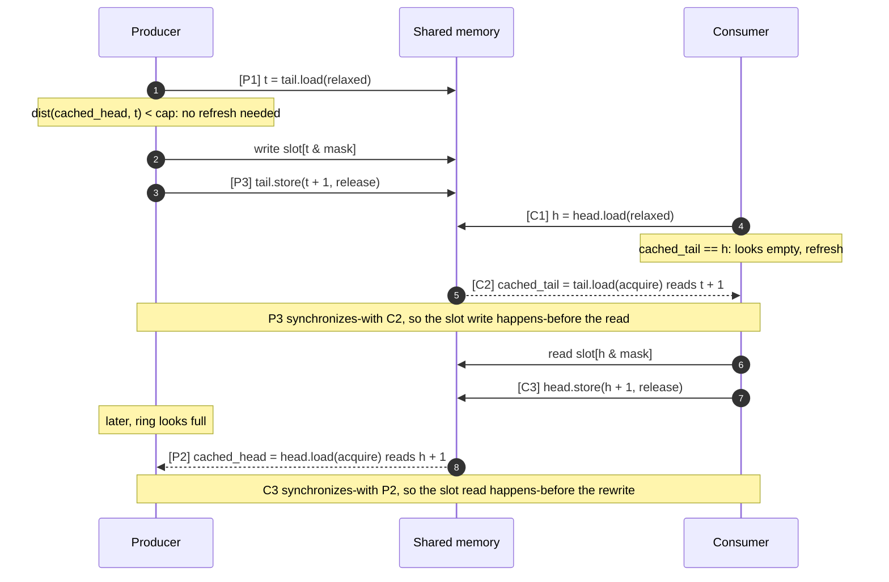

# Memory ordering of the SPSC ring

> **Status:** written in M1.4, **before** the ring implementation, and approved by the owner
> (2026-10-17). The M1.5 code in `spsc_ring_view.hpp` was checked against §12. Every atomic operation in
> `spsc_ring_view.hpp` carries a tag (`[P1]`, `[C3]`, …) that points to a row of §4. If the code and this
> document disagree, the code is wrong until this document is updated and re-reviewed.
>
> Scope: `SpscRingView<T, IndexT>` from [PRD_spsc_ring.md](PRD_spsc_ring.md), one producer thread,
> one consumer thread, C++20 memory model. Cross-process use (M2) is covered in §10.

## 1. Vocabulary

| Term | Meaning |
|---|---|
| `tail` | Counter of the next slot the producer will write. Written **only** by the producer. |
| `head` | Counter of the next slot the consumer will read. Written **only** by the consumer. |
| `cap`, `mask` | Capacity (power of two) and `cap − 1`. Slot of counter `i` is `i & mask`. |
| `dist(a, b)` | `static_cast<IndexT>(b − a)`: the number of steps from `a` to `b`, modulo `2^n` (`n` = bits of `IndexT`). |
| `cached_head` | The producer's last observed value of `head`. Plain (non-atomic), producer-only. |
| `cached_tail` | The consumer's last observed value of `tail`. Plain (non-atomic), consumer-only. |
| sb / sw / hb | *sequenced-before*, *synchronizes-with*, *happens-before* (C++ [intro.races]). |

Counters are **monotonic**: they only ever increase by 1 (modulo `2^n`) and are never reset while
the ring is in use. The slot index is derived by masking; the counters themselves are never masked.

## 2. Layout: who writes what

`SpscRingHeader<IndexT>` (in `fastbus/core/spsc_ring_layout.hpp`) is four `kFalseSharingRange`
(128-byte) blocks followed by the slot array ([ADR-009](adr/ADR-009-cache-line.md)):

| Block | Offset | Fields | Written by | Read by |
|---|---|---|---|---|
| 0 | 0 | `tail` (atomic) | producer, every push | consumer, only when its cache says *empty* |
| 1 | 128 | `cached_head`, `producer_mask` | producer, only on refresh | producer |
| 2 | 256 | `head` (atomic) | consumer, every pop | producer, only when its cache says *full* |
| 3 | 384 | `cached_tail`, `consumer_mask` | consumer, only on refresh | consumer |
| slots | 512 | `T[cap]` | producer (slots it owns) | consumer (slots it owns) |

Each side's hot path touches only its own two blocks plus the slot it owns. The other side's block
is read only on a refresh, which is what removes most cache-line ping-pong (§7). The mask is
stored once per side so neither side ever reads a line the other side writes just to find a slot.

## 3. The ownership invariant

At every moment:

- **I1 (bounds):** `0 ≤ dist(head, tail) ≤ cap`.
- **I2 (ownership):** slots for counters in `[head, tail)` belong to the **consumer**; all other
  slots belong to the **producer**. A thread reads or writes a slot's bytes only while it owns it.
- **I3 (transfer):** ownership moves only through a publishing store: the producer hands slot
  `tail` to the consumer by storing `tail + 1` ([P3]); the consumer hands slot `head` back by
  storing `head + 1` ([C3]).

I2 and I3 are what make the non-atomic slot accesses data-race-free. §5 proves that every
transfer creates a happens-before edge, so two accesses to the same slot bytes by different
threads are always ordered.

## 4. Every atomic operation

| Tag | Thread | Operation | Order | Why this order (details in §5–§6) |
|---|---|---|---|---|
| **P1** | producer | `t = tail.load()` | `relaxed` | Own index; the producer is its only writer (§6.1). |
| **P2** | producer | `cached_head = head.load()` (only if `dist(cached_head, t) == cap`) | `acquire` | Pairs with [C3]: the consumer's reads of a slot hb the producer's rewrite of it (§5.2). |
| — | producer | write slot `t & mask` | non-atomic | Producer owns it (I2). |
| **P3** | producer | `tail.store(t + 1)` | `release` | Pairs with [C2]: the slot write hb the consumer's read (§5.1). |
| **C1** | consumer | `h = head.load()` | `relaxed` | Own index; the consumer is its only writer (§6.1). |
| **C2** | consumer | `cached_tail = tail.load()` (only if `cached_tail == h`) | `acquire` | Pairs with [P3] (§5.1). |
| — | consumer | read slot `h & mask` | non-atomic | Consumer owns it (I2). |
| **C3** | consumer | `head.store(h + 1)` | `release` | Pairs with [P2] (§5.2). |
| **Q1** | any | `h = head.load()` in `size_approx` | `acquire` | Guarantees the following [Q2] sees `tail ≥ h` (§8). |
| **Q2** | any | `t = tail.load()` in `size_approx` | `relaxed` | Ordered after [Q1] by [Q1]'s acquire (§8). |

Claim/commit and peek/release use exactly the same operations: `try_claim()` = [P1] + [P2] and
returns a pointer to the slot instead of writing it; `commit()` = [P1] + [P3]. `try_peek()` = [C1] + [C2];
`release()` = [C1] + [C3]. (`commit`/`release` re-read their own counter with [P1]/[C1] so no
state has to be kept between the claim and the commit.) No other atomic accesses exist on the hot path. Debug-only misuse checks
(owner thread ids, M1.5) use their own `relaxed` atomics and are not part of the protocol.

## 5. Happens-before arguments

### 5.1 Publication: the slot write happens-before the consumer reads it (no torn reads, G3)

Let the producer write slot `s` for counter `t`, then perform [P3] `tail.store(t + 1, release)`.
Later the consumer performs [C2] `tail.load(acquire)` and reads some value `v` with
`dist(h, v) ≥ 1`, i.e. counter `t` lies in `[h, v)`, and then reads slot `s`.

1. write(slot `t`) **sb** [P3 for `t + 1`] (program order in the producer).
2. The value `v` was written by some [P3] store `S_v` for counter `v − 1 ≥ t`. Since all stores to
   `tail` are by the producer in increasing order, [P3 for `t + 1`] is `S_v` or **sb** `S_v`.
3. `S_v` is a release store and [C2] is an acquire load that reads its value, so `S_v` **sw** [C2].
4. [C2] **sb** read(slot `t`) (program order in the consumer).

Therefore write(slot `t`) **hb** read(slot `t`). The consumer sees the complete value.

Note on C++20: since P0982R1 a *release sequence* is extended only by read-modify-write
operations, not by later plain stores of the same thread. The argument above does not rely on
release sequences: it uses the store the consumer actually read (`S_v`), which is itself a release
store, plus program order in the producer. That is why every [P3] must be `release`, not just the
first one.

### 5.2 Reuse: the consumer's read happens-before the producer overwrites the slot

The producer may overwrite slot `s` (counter `t' = t + cap`) only after it has observed
`dist(head, t') < cap`, i.e. `head ≥ t + 1`. That observation is either the current [P2] or an
earlier [P2] whose value is still in `cached_head`.

1. read(slot `t`) **sb** [C3 for `t + 1`] in the consumer.
2. The [P2] that loaded the value `w ≥ t + 1` read a release store `S_w` that is [C3 for `t + 1`]
   or comes after it in the consumer's program order, so [C3 for `t + 1`] **sb** `S_w` (or equal).
3. `S_w` **sw** [P2] (release → acquire).
4. [P2] **sb** write(slot `t'`) in the producer (directly, or via an earlier [P2] whose cached
   value is used: that earlier [P2] still **sb** the write).

Therefore read(slot `t`) **hb** write(slot `t + cap`). The consumer never reads a slot that is
being overwritten, and the write-after-read on the same bytes is not a data race.

### 5.3 FIFO and exactly-once (G1, G2)

The producer writes counters `0, 1, 2, …` in order and publishes each with [P3]; the consumer
reads `head, head + 1, …` in order and only while `head ≠ tail`. Each counter is written once,
published once, read once and freed once. Wrapping counters do not break this as long as I1
holds and `cap ≤ 2^(n−1)` (§9).

## 6. Why these orders and no stronger

### 6.1 `relaxed` for a thread's own index ([P1], [C1])

A thread that is the **only writer** of an atomic always reads its own most recent store
(coherence: write-read coherence plus program order). No synchronization is needed because no
other thread writes that variable. The load is atomic only because the other side reads the
same variable concurrently; a plain access would be a data race in the C++ model. (An
implementation may keep the value in a register; the shared-memory layout of M2 is the reason it
lives in the header, see §10.)

### 6.2 Why not `seq_cst`

`seq_cst` adds a single total order over all `seq_cst` operations. That matters for
store-then-load patterns on *two different* variables (Dekker / Peterson: "I set my flag, then
read yours"). The ring has no such pattern. Each decision a thread makes depends on **one**
variable written by **one** other thread, and §5 needs only the two release→acquire edges. Using
`seq_cst` would be correct but slower: on x86 a `seq_cst` store compiles to `xchg` (or `mov` +
`mfence`), a full barrier costing tens of cycles, while a release store is a plain `mov`. On
ARMv8.3+ an acquire load can use the cheaper `ldapr` instead of `ldar`.

### 6.3 Why no standalone fences

The same protocol could be written with `relaxed` operations plus `std::atomic_thread_fence`.
We do not do that:

- It is not faster here: the operation-level orders already compile to the minimal instructions.
- ThreadSanitizer does not model standalone fences (GCC warns with `-Wtsan` when
  `atomic_thread_fence` is used under `-fsanitize=thread`). TSan would then report false races or
  miss real ones, and TSan is our main correctness check for this code (M1.8).
- Operation-level orders keep each edge visible at the operation it belongs to, which is easier to
  review against §4.

## 7. Cached indices

**Why:** without caching, every push reads `head` and every pop reads `tail`. Each of those reads
pulls in the cache line the other core is writing on every operation, so the line bounces
between the two cores constantly (ping-pong) and each bounce costs a cross-core transfer. With
caching the producer reads `head` only when the ring *looks* full, and the consumer reads `tail`
only when it *looks* empty. In a steady stream that is roughly once per `cap` items instead of once
per item.

**Why it stays correct:** `head` only ever moves forward, and `cached_head` holds a value that
`head` had at some earlier moment. So `cached_head` is never *ahead of* `head`, and
`dist(cached_head, tail) ≥ dist(head, tail)`. The producer therefore computes *at least* the real
occupancy: a stale cache can make the ring look **fuller** than it is (the producer then refreshes
via [P2], or reports full when it actually just stopped being full), never **emptier**. A producer
never writes a slot the consumer still owns. Symmetrically, `cached_tail` is never ahead of `tail`,
so the consumer may see the ring as **emptier** than it is, never as containing an item that is
not yet published. The cached values were obtained by acquire loads ([P2], [C2]), so the
happens-before edges of §5 are already established for every slot the cache lets a thread use.

Both comparisons stay meaningful under counter wrap because every distance involved is in
`[0, cap]` and `cap ≤ 2^(n−1)` (§9).

The cached fields are plain, not atomic: each is read and written by exactly one thread, so no
data race exists, and they live in blocks the other side never touches.

## 8. `size_approx` from any thread

`size_approx()` performs [Q1] `h = head.load(acquire)`, then [Q2] `t = tail.load(relaxed)`, and
returns `min(dist(h, t), cap)`.

- **Lower bound (never negative):** the consumer stored `h` ([C3]) only after it had observed
  `tail ≥ h` through [C2]. [Q1] reads that release store, so the consumer's [C2] **hb** [Q2]. By
  read-read coherence [Q2] cannot see an older `tail` than [C2] did, so `t ≥ h`. The acquire on
  [Q1] also keeps [Q2] from being reordered before it. Reading `tail` first instead could observe
  `tail` before a later `head`, giving `dist` a "negative" (huge unsigned) value.
- **Upper bound:** between [Q1] and [Q2] the consumer may pop and the producer may push again, so
  `dist(h, t)` can exceed `cap` for an observer on a third thread. The result is clamped to `cap`.
- When both sides are idle, the value is exact. From the producer or consumer thread itself, it is
  exact for that side's own index and approximate for the other.

## 9. Counter wrap: why `cap ≤ 2^(n−1)`

All counters are `IndexT` with `n` bits and wrap modulo `2^n`. The ring only ever computes
distances `dist(a, b)`, which are exact as long as the true distance is in `[0, 2^n)`.
The occupancy `dist(head, tail)` takes every value in `[0, cap]`, which is `cap + 1` values. To
tell *full* (`cap`) from *empty* (`0`) we need `cap < 2^n`. The largest power of two below `2^n`
is `2^(n−1)`, i.e. **half the index range**. So `uint8_t` allows up to 128 slots and `uint16_t`
up to 32768. The default `uint64_t` never wraps in practice (≈ 584 years at 1 item/ns), and tests
use `uint8_t`/`uint16_t` with start offsets near the wrap point to exercise wrapping cheaply (M1.6).
`SpscRingLayout::valid_capacity` enforces the bound.

## 10. Cross-process use (M2)

The same header and argument apply when the ring lives in shared memory mapped by two processes:

- The atomics must be **lock-free** (a lock-based `std::atomic` would put the lock in one process's
  memory). `RingIndex` requires `std::atomic<IndexT>::is_always_lock_free`, and the layout asserts
  `sizeof(std::atomic<IndexT>) == sizeof(IndexT)`.
- The header holds **no pointers**, only counters and masks, so it is valid at any mapping address.
- TSan only instruments one process, so it cannot check the cross-process case; that is covered by
  the M2 stress tests and recorded as a known issue in M1.8.
- A crashed or malicious peer could corrupt `head`, `tail` or the masks. M2 validates them on
  attach and bounds-checks before use; M1 trusts the single process.

## 11. Timeline of one push and one pop

## 12. Review checklist for M1.5 (checked 2026-10-17 against `spsc_ring_view.hpp`)

- [x] Every atomic access in `spsc_ring_view.hpp` has a tag from §4 and uses exactly that order.
- [x] No atomic access exists that is not in §4 (except debug-only owner checks in `thread_owner.hpp`).
- [x] `head` is stored only by consumer code paths and `tail` only by producer code paths.
- [x] The slot is written strictly before [P3] and read strictly before [C3].
- [x] `cached_head` / `cached_tail` are only refreshed by [P2] / [C2].
- [x] No `std::atomic_thread_fence`, no `seq_cst`, no `compare_exchange` in the ring (the only CAS is the debug-only `ThreadOwner`).
